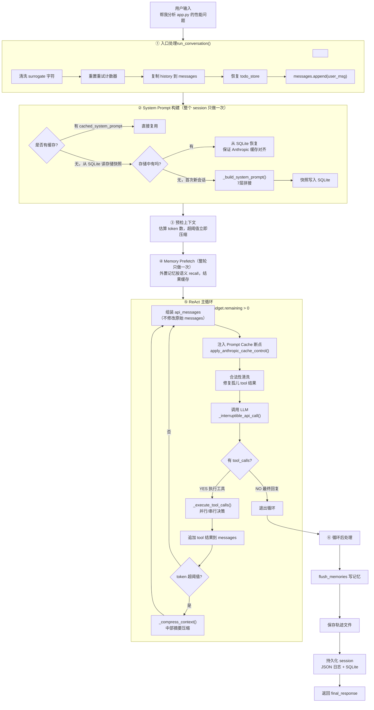
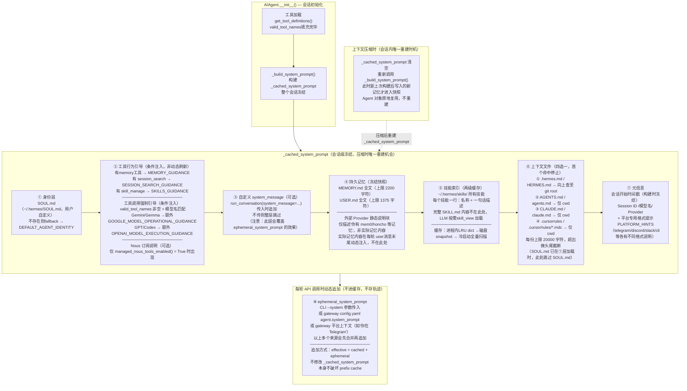
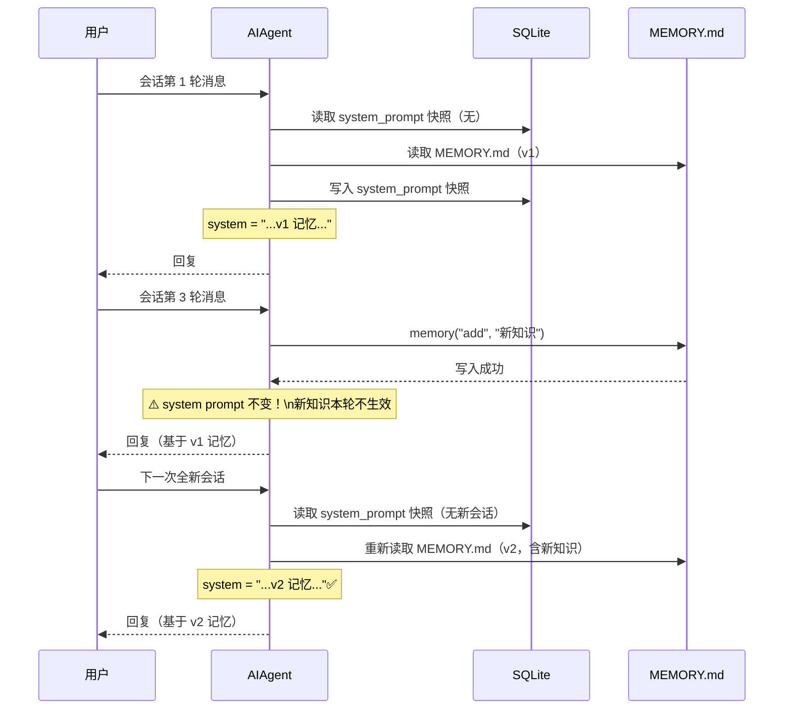
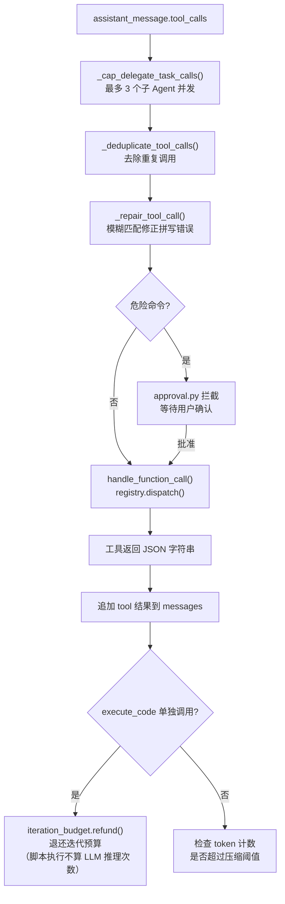
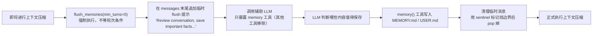
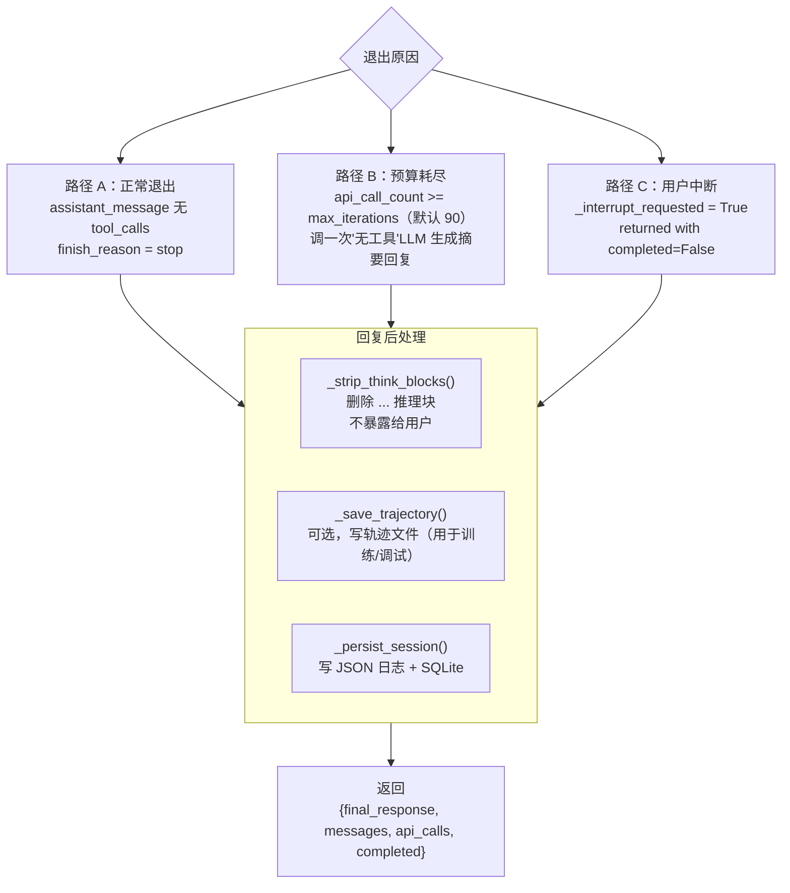

# 二、Agent 核心实现：一条消息的完整生命周期

Hermes 的 Agent 核心本质上是一个**同步编排引擎**：接收用户消息，构建完整上下文，进入 LLM + 工具的反复循环，直到生成最终回复。整个过程只有两个核心对象在流动——`messages`（完整对话历史）和 `iteration_budget`（防死循环预算计数器）。

理解 Hermes 的关键在于：**LLM 每次调用都收到完整的上下文，不存在隐藏状态机**。Agent 的"智能"体现在 LLM 对 messages 列表的推理上，而不是某个复杂的状态图。

### ▎入口：两个接口，一条代码路径

`AIAgent` 对外暴露两个接口，但底层走同一条路径：

```python
# run_agent.py
def chat(self, message: str) -> str:
    """简单接口，直接返回字符串。CLI 模式和简单脚本使用。"""
    result = self.run_conversation(message)
    return result.get("final_response", "")

def run_conversation(self, user_message, conversation_history=None, task_id=None) -> dict:
    """完整接口，返回 {final_response, messages, api_calls, ...}。
    Gateway（Telegram / Discord / Slack）始终调用这个。"""
```

## 消息的完整旅程

下图展示了一条用户消息从进入到生成回复的完整链路：



---

## 第一步：消息列表构建

**是什么**：`run_conversation()` 的第一件事，把传入的历史列表和当前消息拼成一个 `messages` 列表，同时做一批防御性清洗。

**为什么有那么多清洗操作**：Hermes 运行在 CLI、Gateway（Telegram/Discord/Slack）、批处理、API 服务器等多种宿主环境。每种环境的调用方行为各异，不做清洗任何一个环境都可能导致 LLM 调用崩溃。这些操作是 `run_conversation()` 的最后一道输入防线。

```python
# run_agent.py ~7162
# 1. 清洗 surrogate 字符（Google Docs/Word 粘贴会带入孤立 UTF-16 代理对）
user_message = _sanitize_surrogates(user_message)

# 2. 复制 history，不修改调用方传入的原始 list
messages = list(conversation_history) if conversation_history else []

# 3. 删除上轮残留的预算压力警告（轮次级信号，不能跨轮保留，否则 GPT 系
#    模型会误以为永远不应该再调用工具）
_strip_budget_warnings_from_history(messages)

# 4. Gateway 每条消息新建 AIAgent，todo 内存状态清空；
#    需要从最近一次 todo 工具响应反向扫描历史，重建 todo_store
if conversation_history and not self._todo_store.has_items():
    self._hydrate_todo_store(conversation_history)

# 5. 追加当前消息
messages.append({"role": "user", "content": user_message})
```

**messages 的数据结构**：

```
messages 列表（OpenAI 格式）：
[
  {"role": "user",      "content": "上一轮提问"},
  {"role": "assistant", "content": "思考...",
                        "tool_calls": [{"id":"tc1","function":{"name":"read_file","arguments":"{...}"}}]},
  {"role": "tool",      "content": "文件内容...", "tool_call_id": "tc1"},
  {"role": "assistant", "content": "分析完毕，..."},   ← 上轮最终回复

  {"role": "user",      "content": "帮我分析 app.py 的性能问题"}  ← 当前消息
]
```

---

## 第二步：System Prompt 拼接（会话级缓存）

**是什么**：把 Agent 的身份、工具说明、记忆快照、技能索引等 7 层内容拼接成一个完整的 system 字符串，整个会话只拼一次。

**为什么只构建一次，不是每轮刷新**：这是 Anthropic prefix cache 的硬约束。Anthropic 的缓存机制要求 prompt 前缀完全不变才能命中——system prompt 一旦在对话中途变化，缓存立刻失效，所有 input token 重新按原价计费，成本瞬间变为 10 倍。整个会话保持 system 不变是"冻结快照"设计的核心原因。

### System Prompt 7 层结构



### ▎工程细节：内存缓存 + SQLite 双层保障

System Prompt 的"只构建一次"依赖两个存储层协同工作：

```
层 1：Python 对象内存（self._cached_system_prompt）
  作用域：同一个 AIAgent 对象的多轮对话内复用
  失效时机：AIAgent 对象销毁（Gateway 每条消息新建 Agent → 每轮重新进入此层）
  压缩后：self._cached_system_prompt = None → 下轮强制重建（重读磁盘记忆）

层 2：SQLite sessions 表（system_prompt 列）
  写入时机：run_conversation() 首次构建后，立即写入
            self._session_db.update_system_prompt(session_id, prompt)
  读取时机：同一 session_id 的续接会话（如 Gateway 下一条消息）从 SQLite 恢复
  目的：让 Anthropic 侧每次收到的 system 内容完全一致，prefix cache 持续命中

Gateway 消息处理路径（每条消息新建 AIAgent）：
  新 Agent → 查 SQLite → 有快照 → 恢复上次 system prompt
  → Anthropic 收到与上轮完全相同的 system → prefix cache 命中 ✅
```

进程重启后 Anthropic prefix cache 失效（API 侧默认 5 分钟 TTL），但 SQLite 快照保证了内容一致性，新会话重建后从第二次 API 调用起重新命中。

### 为什么记忆写入当前会话不生效？



这是"冻结快照"设计的直接结果：记忆写入立即落盘，但当前会话的 system prompt 不变。唯一例外是上下文压缩触发后，`_invalidate_system_prompt_cache()` 会清空缓存并重读磁盘，重建时把新记忆带入新 session 的 system。

---

## 第三步：ReAct 主循环

**是什么**：ReAct = **Re**ason（推理）+ **Act**（行动）。LLM 每次推理后，要么继续行动（调工具），要么终止（输出最终回复）。这是整个 Agent 最核心的控制结构。

### 每轮循环内部流程

```mermaid
flowchart LR
    A["messages（持久历史）"] --> B["构建 api_messages\n（临时副本，不修改原始）"]

    subgraph B["构建 api_messages"]
        B1["复制消息，删除内部字段\nreasoning / finish_reason 等"]
        B2["当前轮 user 消息末尾\n追加外置记忆 prefetch 结果"]
        B3["头部插入 system prompt\n+ ephemeral_system_prompt"]
        B4["apply_anthropic_cache_control()\n注入 4 个 cache_control 断点"]
        B5["_sanitize_api_messages()\n修复孤儿 tool 结果"]
    end

    B --> C["LLM API Call\n_interruptible_api_call()"]

    C --> D{响应类型}
    D -->|"有 tool_calls"| E["_execute_tool_calls()"]
    D -->|"纯文本"| F["final_response\n退出循环"]

    E --> E1{并行还是串行?}
    E1 -->|"全是只读工具"| E2["ThreadPoolExecutor\n最多 3 并发"]
    E1 -->|"含写操作 / clarify"| E3["顺序串行执行"]
    E2 --> E4["追加 tool 结果\n到 messages"]
    E3 --> E4
    E4 --> END
```



### ▎IterationBudget：防死循环的预算计数器

**是什么**：`IterationBudget` 是一个线程安全的计数器，在每次 LLM API call 发出前 `consume()` 一次。父 Agent 默认上限 90 次，子 Agent 默认 50 次，两者独立计数互不影响。

```python
# run_agent.py ~7455
while api_call_count < self.max_iterations and self.iteration_budget.remaining > 0:
    api_call_count += 1
    if not self.iteration_budget.consume():   # 一次 API call = 一次 budget
        _turn_exit_reason = "budget_exhausted"
        break
    # ... LLM 调用
```

**例外：execute_code 退还预算**。`execute_code` 只是在沙箱里跑代码，没有 LLM 推理，执行完成后调用 `iteration_budget.refund()` 退还本次消耗，避免纯脚本执行吃掉推理预算。**触发条件**：本轮 `tool_calls` 集合必须是 `{"execute_code"}` 这一个工具（源码判断：`_tc_names == {"execute_code"}`）——若同轮还有其他工具，则不退还。子 Agent 的 budget 完全独立，父 Agent budget 耗尽时，已启动的子 Agent 在 `ThreadPoolExecutor` 的独立线程里继续跑完自己的 50 次上限。

**budget 耗尽时不是直接报错**：`_handle_max_iterations()` 向 messages 追加一条新的 user 消息，再在循环外发起一次额外 API call（不受 budget 约束），让模型生成"已完成工作摘要"作为最终回复返回给用户。

### Prompt Caching 的 4 个断点

```
api_messages（发送给 LLM 的最终版本）：

[0] {"role":"system", "content":[{..., "cache_control":{"type":"ephemeral"}}]}
                                       ↑ 断点 1：system（最大收益，每轮稳定）

[1] {"role":"user",      "content":"第 1 轮提问"}
[2] {"role":"assistant", "content":"第 1 轮回复"}
[3] {"role":"user",      "content":"第 2 轮提问"}
[4] {"role":"assistant", "content":[{..., "cache_control":{"type":"ephemeral"}}]}
                                         ↑ 断点 2（滑动窗口，最近 3 条非 system 消息）
[5] {"role":"tool",      "content":"工具结果", "cache_control":{"type":"ephemeral"}}
                                                ↑ 断点 3
[6] {"role":"user",      "content":"当前消息", "cache_control":{"type":"ephemeral"}}
                                               ↑ 断点 4
```

**节省效果**：system prompt（通常 2000~8000 token）从首轮后就从缓存读取，成本降至原价的 10%。"整个会话节省约 75%"是多轮对话的经验均值，不是单次请求的折扣率——实际节省随 system prompt 占比而变，system 越长节省越高，rolling window 的最近 3 条消息每轮都有部分新增不命中缓存。

### ▎临时注入：api_messages 与 messages 的分离

**是什么**：每轮循环开始时，从 `messages`（真正的历史）构建 `api_messages`（发给 LLM 的临时副本），把 memory prefetch 结果、预算压力警告、合法性修复等内容注入 `api_messages`，但**不写回 **`**messages**`。这样注入的内容是一次性的、轮次级的，不会污染持久历史。

```python
# run_agent.py 主循环：每轮重建 api_messages
api_messages = list(messages)           # 浅拷贝，不修改原始 messages

# 注入 memory prefetch（用户消息末尾追加语义记忆）
# 注入 cache_control 断点（apply_anthropic_cache_control）
# 注入合法性修复（_sanitize_api_messages：补齐孤儿 tool 结果）

# 预算压力警告注入位置：最后一个 tool result 的 JSON content 内部
# ── 不新增消息，不破坏 role 交替，不引入额外 cache breakpoint ──
budget_warning = self._get_budget_warning(api_call_count)
if budget_warning and messages[-1].get("role") == "tool":
    parsed = json.loads(messages[-1]["content"])
    parsed["_budget_warning"] = budget_warning
    messages[-1]["content"] = json.dumps(parsed)
```

### ▎API 调用失败的恢复机制：Credential Refresh + Fallback Chain

**是什么**：LLM 调用失败后，系统按错误码分级处理，目标是在不打断用户的情况下自动恢复：

```
错误码处理优先级：

401 → 先尝试 Credential Refresh（不是重读 .env，而是 OAuth/JWT 重新签发）
      Codex → resolve_codex_runtime_credentials(force_refresh=True)
      Nous  → resolve_nous_runtime_credentials(force_mint=True)
      Refresh 成功 → 热替换凭据，重试当前请求
      Refresh 失败 → 轮换到 Credential Pool 中的下一份凭据（已失败的标记 exhausted）

429 → 第一次：同一凭据等待重试；第二次：轮换到 Pool 下一份
402 → 计费耗尽，立即轮换 Pool

整个 Credential Pool 耗尽 → 触发主 Fallback Chain（切换到备用 provider）
所有 fallback 都失败 → 返回 error，当前 turn 终止
```

---

## 第四步：工具执行与上下文压缩

### 工具执行流程



### ▎并行 vs 串行：四层决策规则

**是什么**：LLM 一次可以返回多个 `tool_calls`，`_should_parallelize_tool_batch()` 用四层规则决定是否并发执行：

```
规则 1（最高优先级）：含 clarify？→ 强制串行
  clarify 需要等待用户输入，并发无意义且容易产生竞态

规则 2：全部工具在 _PARALLEL_SAFE_TOOLS 白名单？→ 并行
  {read_file, web_search, web_extract, session_search, vision_analyze, ...}
  这些工具只读或无共享状态，天然安全

规则 3：全是路径范围工具（PATH_SCOPED_TOOLS）且路径不重叠？→ 并行
  read_file("a.py") + read_file("b.py") → 不重叠 → 并行 ✅
  write_file("a.py") + write_file("a.py") → 同路径 → 串行 ❌

规则 4：其他 → 串行（保守兜底）
  terminal、代码执行等有副作用工具，宁可慢也不引入竞态
```

并行时主线程用 `concurrent.futures.wait(futures)` 阻塞等待，所有工具完成后一次性把结果追加到 messages，再进入下一轮 LLM 推理。主线程在等待期间无其他工作，是纯粹的阻塞等待。

### ▎工具异常处理：捕获为 result，不中断循环

**是什么**：无论并行还是串行路径，工具抛出的异常都被捕获并转换为 tool result 字符串，让模型看到错误信息后自我纠错，不会 raise 到主循环：

```python
# run_agent.py _run_tool（并发 worker 内）
def _run_tool(index, tool_call, function_name, function_args):
    try:
        result = self._invoke_tool(function_name, function_args, ...)
    except Exception as tool_error:
        # 异常转字符串，追加到 messages，让模型自我纠错
        result = f"Error executing tool '{function_name}': {tool_error}"
        logger.error("_invoke_tool raised: %s", tool_error, exc_info=True)
    # result 无论如何都追加到 messages，不 raise
```

**approval timeout**：`prompt_dangerous_approval()` 默认 60 秒超时（可在 `approvals.timeout` 配置），超时返回 `"deny"`，工具拒绝执行，`"[Command denied by user]"` 作为 tool result 追加。本次 API call 的 budget 已消耗，不退还。

### ▎delegate_task vs execute_code：两种子任务分发模式

**是什么**：两个工具都可以把工作分发出去，但运作机制和适用场景完全不同：

```
delegate_task（子 Agent 委派）：
  实现：启动完整的 AIAgent 实例，有独立会话、独立 terminal、独立迭代预算（默认 50 次）
  父 Agent 收到：只有最终文本摘要，子 Agent 的中间工具调用永不进入父 context
  适用：推理密集型子任务（调试、代码审查、研究综合）、需要隔离上下文的并行工作流

execute_code（沙箱代码执行）：
  实现：在隔离 sandbox 运行代码片段，无 LLM 推理，执行完退还 budget
  父 Agent 收到：代码的 stdout/stderr
  适用：机械式数据处理、无需推理的脚本化流水线

关键约束：
  execute_code 在 DELEGATE_BLOCKED_TOOLS 中 → 子 Agent 不能调用 execute_code
  delegate_task 的 tasks 参数最多传 3 个 → 超出的被截断（不是排队，不是报错）
  子 Agent 修改文件 → 父 Agent 需主动 read_file，无自动同步
  委派深度限制 MAX_DEPTH=2 → 父(0)→子(1)→孙子(2) 直接报错被拒绝，不是静默丢弃
```

### 上下文压缩触发点

**是什么**：`run_agent.py` 内的 Agent ContextCompressor 在每轮工具执行结束后检查 token 数，超过阈值就压缩当前 `messages`。

```
每次工具执行后：
  if last_prompt_tokens >= context_length × 50%:
      ⟳ compacting context…

压缩后消息列表变化：

压缩前（200 条，~120K tokens）：
  [system] [user-1] [assistant-1] [tool-1] ... [user-50] [assistant-50] [tool-50]
   ↑头部保护                  ↑↑↑ 中部（被摘要替换）↑↑↑            ↑↑↑尾部保护↑↑↑

压缩后（~30 条，~30K tokens）：
  [system'] [user-1] [assistant-1]  ←头部（含 prefix note）
  [user: "[CONTEXT COMPACTION]\n## Goal\n...\n## Relevant Files\n..."]  ←结构化摘要
  [user-45]...[user-50][assistant-50][tool-50]  ←尾部（最近 ~20K tokens）
```

### ▎双层压缩架构：50% Agent 层 + 85% Gateway 层

**是什么**：实际存在两个完全独立的压缩层，文档图中展示的只是内层：

```
┌──────────────────────────────────────────────────────────────────┐
│ Gateway Session Hygiene（外层，85% 阈值）                        │
│  位置：agent.run_conversation() 被调用之前                        │
│  目的：防止"续接大会话时，历史还没开始新对话就已经超限"的场景       │
│  触发：messages token 估算 >= context_length × 85%               │
│        或 message 条数 >= 1000（硬安全阀）                        │
│                                                                  │
│  ┌──────────────────────────────────────────────────────────┐    │
│  │ Agent ContextCompressor（内层，50% 阈值）                 │    │
│  │  位置：run_conversation() 主循环内，每轮工具调用结束后      │    │
│  │  token 来源：优先使用 API 返回的精确 prompt_tokens          │    │
│  │              无精确值时回退粗略估算（字符数 ÷ 4）           │    │
│  └──────────────────────────────────────────────────────────┘    │
└──────────────────────────────────────────────────────────────────┘
```

两层阈值为什么故意不同：Gateway 层用 85% 是为了避免"每轮都压缩"——如果 Gateway 层也用 50%，那么 Agent 层每次触发后历史降到 50% 以下，下一轮消息进来很快就到 50% 又触发 Gateway 压缩，导致过度压缩。85% 给 Agent 内层留足了运转空间。

### ▎压缩机制的四个工程细节

**① 摘要生成失败有静态兜底，不是无声丢失**：辅助 LLM 生成摘要失败时，插入固定占位符告知模型上下文已丢失，而非静默截断：

```python
# agent/context_compressor.py
if not summary:
    logger.warning("Summary generation failed — inserting static fallback")
    summary = (
        f"{SUMMARY_PREFIX}\n"
        f"Summary generation was unavailable. {n_dropped} conversation turns were "
        f"removed to free context space but could not be summarized..."
    )
    # 失败后设置冷却时间，避免连续频繁调用辅助模型
    self._summary_failure_cooldown_until = time.monotonic() + cooldown_seconds
```

**② stub result 的确切内容**：`_sanitize_api_messages()` 为压缩后孤立的 `tool_call`（其结果已被摘要替换）注入固定字符串 `"[Result unavailable — see context summary above]"`，使 tool_call / result 始终成对，LLM 不会看到结构异常的 messages。

**③ 摘要大小有硬限制，不会无限增长**：

```python
# agent/context_compressor.py
_SUMMARY_TOKENS_CEILING = 12_000  # 绝对上限

self.max_summary_tokens = min(
    int(self.context_length * 0.05),  # 模型上下文窗口的 5%
    _SUMMARY_TOKENS_CEILING,           # 不超过 12K tokens
)
# 连续压缩时，旧摘要通过 _previous_summary 传给辅助模型要求"更新而非重写"
# 无论压缩多少次，摘要不会超过 12K tokens
```

**④ 压缩后 role 交替始终合法**：压缩插入摘要消息时，代码检查头尾消息的 role，智能选择摘要消息的 role 以避免连续相同 role；若两种选择都冲突，则将摘要合并进尾部第一条消息的 content（`_merge_summary_into_tail`），保证 messages 合法性。

---

## 第五步：记忆写入与技能生成

### 自动记忆 Flush（压缩前的关键保护）

**是什么**：上下文压缩会丢弃中间轮次的对话细节。为了不让重要知识随压缩消失，Hermes 在压缩前强制触发记忆 flush——启动一个临时辅助 Agent，只暴露 `memory` 和 `skill_manage` 两个工具，让它主动把重要信息写到磁盘。



### [自动技能生成（Skill Nudge）](./04-技能系统-注册发现与调用.md)

**是什么**：当 Agent 在一次 `run_conversation()` 中累计工具调用迭代达到阈值（默认 10 次，可通过 `skills.creation_nudge_interval` 配置），Hermes 在**对话结束后**于后台线程启动一个独立的 review Agent，由它自主判断是否有值得保存的技能：

```
_iters_since_skill += 1  （每次 API call 前累加）

当计数 ≥ _skill_nudge_interval（默认 10）时：
    run_conversation() 主循环退出后，设置 _should_review_skills = True

    → _spawn_background_review() 在独立后台线程启动 review Agent
    → review Agent 用 _COMBINED_REVIEW_PROMPT 作为用户消息，复盘整段对话
    → review Agent 自主决定是否调用：
      skill_manage(action="create", name="docker-debug", content="...")

    写入 → ~/.hermes/skills/docker-debug/SKILL.md
    下次同类任务 → skills 索引出现在 system prompt 第 5 层 → LLM 主动加载并复用

注意：整个过程在主对话响应返回后异步发生，不注入 user 消息，对用户不可见
```

---

## 退出循环，生成最终回复

### 三种退出路径



## 关键设计不变量

| 不变量 | 如何保证（代码实现） |
|---|---|
| System Prompt 跨轮不变 | `_cached_system_prompt`（内存）+ `sessions.system_prompt`（SQLite）双层。Gateway 每轮新建 Agent 后从 SQLite 恢复快照，Anthropic prefix cache 持续命中。 |
| 记忆写入"下轮生效" | memory 写磁盘但不重建当前会话 system prompt；压缩触发 `_invalidate_system_prompt_cache()` 后，新 session 重建时才读入新记忆 |
| api_messages 不污染 messages | 每轮从 `messages` 浅拷贝重建 `api_messages`，注入内容（prefetch/警告/缓存断点）全部只写 `api_messages` |
| tool_call / result 必须成对 | `_sanitize_api_messages()` 每轮 API call 前执行：补齐缺失 result（stub 字符串）、删除孤立 result |
| 工具调用不超预算 | `IterationBudget` 线程安全计数，每次 API call 消耗一次；`execute_code` 退还预算；耗尽时在循环外额外调用 LLM 生成摘要回复 |
| 子 Agent 并发不超限 | `_cap_delegate_task_calls()` 截断至 3 个（超出的静默丢弃，不排队不报错）；子 Agent budget 独立，父耗尽不强制中断子 |
