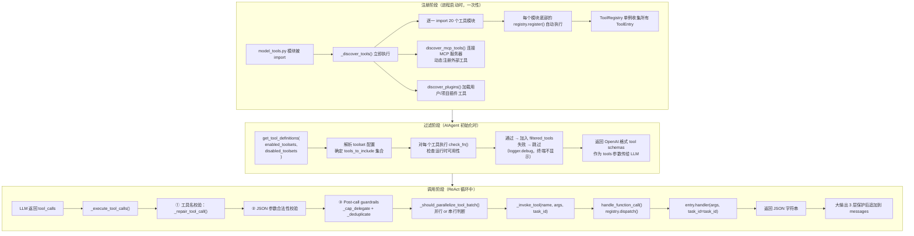
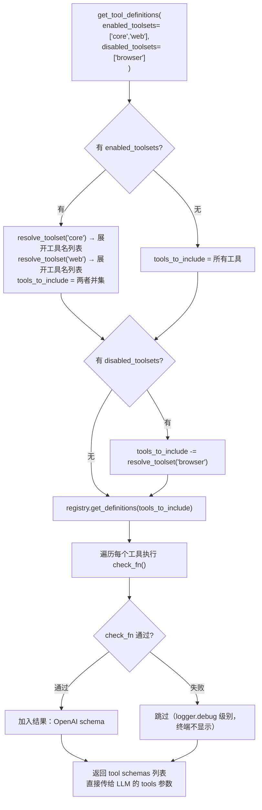
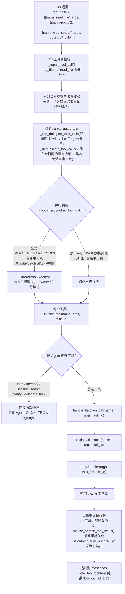
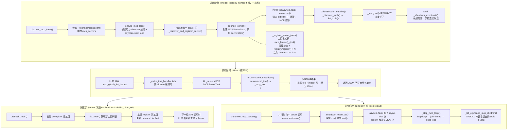
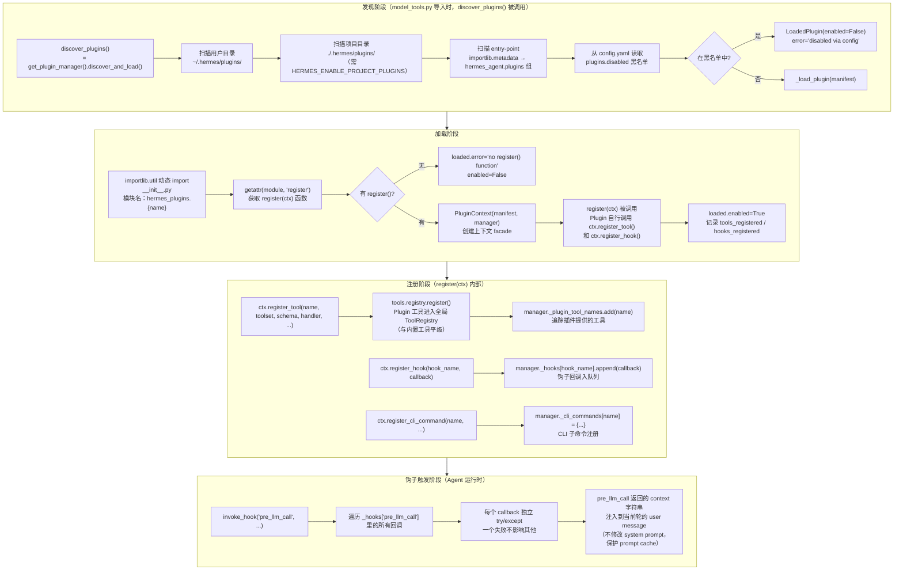

# 三、工具系统：注册、发现与调用

Hermes 的工具系统基于一个简单但强大的设计原则：**工具就是"****副作用导入****"——import 一个模块，工具就自动注册好了**。没有集中式的工具配置文件，没有显式的初始化调用，一切在模块加载时自动完成。

这意味着添加一个新工具只需要创建一个文件，在文件末尾调用 `registry.register()`，然后在 `model_tools.py` 的导入列表里加一行。仅此而已。

## 工具注册：副作用导入模式

一个标准工具文件的结构非常简单——**逻辑函数在前，注册代码在底部**：

```python
# tools/my_tool.py
import json
from tools.registry import registry  # ← 导入全局单例

def analyze_performance(file_path: str, task_id: str = None) -> str:
    """工具实现，必须返回 JSON 字符串"""
    # ... 实际逻辑 ...
    return json.dumps({"result": "..."})

# ─────────────── 模块级注册（import 时自动执行）───────────────
registry.register(
    name="analyze_performance",   # LLM 调用时使用的名称
    toolset="analysis",           # 工具集分组
    schema={                      # OpenAI function calling 格式
        "name": "analyze_performance",
        "description": "分析 Python 文件的性能热点",
        "parameters": {
            "type": "object",
            "properties": {
                "file_path": {"type": "string", "description": "文件路径"}
            },
            "required": ["file_path"]
        }
    },
    handler=lambda args, **kw: analyze_performance(
        file_path=args.get("file_path", ""),
        task_id=kw.get("task_id")
    ),
    check_fn=None,                # None = 始终可用
    requires_env=[],
    max_result_size_chars=50_000,
)
```

### ToolRegistry 数据结构

```
ToolRegistry（全局单例）
│
├── _tools: Dict[str, ToolEntry]
│   ├── "read_file"     → ToolEntry(schema, handler, check_fn, ...)
│   ├── "web_search"    → ToolEntry(schema, handler, check_fn=需要TAVILY_KEY, ...)
│   ├── "terminal"      → ToolEntry(schema, handler, ...)
│   ├── "memory"        → ToolEntry(schema, handler, ...)
│   └── ... （共 60+ 个工具）
│
└── _toolset_checks: Dict[str, Callable]
    ├── "web"    → lambda: bool(os.getenv("TAVILY_API_KEY"))
    ├── "browser"→ lambda: bool(os.getenv("BROWSERBASE_API_KEY"))
    └── ...
```

## 工具的完整生命周期



**enabled_toolsets / disabled_toolsets 由谁决定、在哪里配置**

```
整个系统有三个层次来决定最终哪些 toolset 被启用：
1. 持久化配置：~/.hermes/config.yaml → platform_toolsets
这是最主要的持久配置来源，通过以下两种方式写入：
方式 A：交互式 TUI —— hermes tools
hermes tools enable web       # 命令行直接启用某toolset（默认 cli平台）
hermes tools disable terminal # 命令行直接禁用
hermes tools enable github:create_issue  # MCP 工具用server:tool 格式
hermes tools list --platform telegram# 查看某平台的状态
配置写入 config.yaml 结构如下：

Apply
platform_toolsets:
  cli:
    - web
    - terminal
    - file
    - memory
    - delegation
    # ...telegram:
    - web
    - memory
每个平台独立维护一份列表，cli / telegram / discord 等各自独立。
2. 运行时参数：CLI 命令行 -t / --toolsets
临时覆盖，只对本次会话生效，不写入 config
hermes chat -t web,terminal "帮我搜索..."
hermes chat --toolsets "web,file,memory" "任务..."
3. 代码内硬编码：特殊用途Agent
某些内部Agent 直接在代码里写死 toolset，不走配置：
```

## 工具过滤：按场景只暴露所需工具

不同平台、不同场景需要不同的工具集。`get_tool_definitions()` 根据配置过滤，确保 LLM 只看到它实际可用的工具（减少幻觉，降低 token 消耗）：



### 工具集分层

```
工具集结构：

核心工具（_HERMES_CORE_TOOLS，所有平台默认启用）
  文件：read_file / write_file / patch / search_files
  执行：terminal
  网络：web_search / web_extract
  记忆：memory / session_search
  技能：skill_manage / skill_view / skills_list
  协作：delegate_task
  浏览器：browser_navigate / browser_snapshot / ...（含 check_fn，需 API Key 才实际生效）
  辅助：todo / vision_analyze / execute_code / clarify / ...

check_fn 限制工具（toolset 各有归属，check_fn 失败时跳过）
  browser_navigate   → toolset=browser，需要 BROWSERBASE_API_KEY
  execute_code       → toolset=code_execution，需要 MODAL_TOKEN_ID 或本地沙箱
  web_search (Tavily)→ toolset=web，需要 TAVILY_API_KEY

MCP 动态工具（连接外部 MCP 服务器时懒加载）
  由 mcp_tool.py 在运行时动态注入 registry
  工具名格式：<server_name>__<tool_name>
```

> 注意
> ---
> `_HERMES_CORE_TOOLS` 是 CLI 平台默认启用的**工具名列表**，不代表这些工具的 `toolset` 字段都叫 `core`。例如 `execute_code` 的 toolset 是 `code_execution`，`browser_navigate` 的 toolset 是 `browser`。`check_fn` 失败时该工具会被跳过，跳过日志为 `logger.debug` 级别，正常运行时终端不可见。

---

## 工具调用：从 LLM 输出到执行结果



### 并行判断规则

| 条件 | 结果 |
|---|---|
| 批次只有 1 个工具 | 串行 |
| 含 `clarify` | 强制串行 |
| JSON 参数解析失败（args 非合法 JSON） | 强制串行 |
| 全是 `_PARALLEL_SAFE_TOOLS` 白名单工具（`read_file`/`web_search`/`web_extract`/`vision_analyze`/`session_search`/`skill_view`/`skills_list`/`ha_*` 等） | 并行（线程数 = min(工具数, 8)） |
| `write_file`/`patch`，且目标路径互不重叠 | 并行 |
| 其他工具（不在白名单且不是路径作用域工具） | 串行 |

### Agent 内部工具（不经过 registry）

`_invoke_tool()` 在调用 `handle_function_call()` 前，会先拦截以下工具直接处理（因为它们依赖 Agent 级状态）：

- `todo` — 需要 `TodoStore` 实例
- `memory` — 需要 `MemoryStore` 实例
- `session_search` — 需要 `SessionDB` 实例
- `clarify` — 需要 `clarify_callback` 回调
- `delegate_task` — 需要 `parent_agent` 引用
- memory_manager 插件工具 — 需要 `MemoryManager` 实例

只有这些都不匹配时，才转发到 `handle_function_call()` → `registry.dispatch()`。

#### `_run_async()` 的使用者：注册了 `is_async=True` 的工具

`_run_async()` 不是通用桥接——它**只服务于 handler 本身是 **`**async def**`** 的工具**。注册时声明 `is_async=True`，`registry.dispatch()` 会自动调用它。目前只有 4 类工具使用：`vision_analyze`（httpx 异步请求）、`web_extract`（并发抓取多 URL）、`mixture_of_agents`（并发调用多 LLM）、RL 训练工具 × 10（Atropos 异步环境）。

> **MCP 工具注册时 **`**is_async=False**`：MCP 有自己专属后台 event loop（`_mcp_loop`），handler 内部通过 `_run_on_mcp_loop()` 自行处理 async，对外暴露同步接口，不需要 `_run_async()`。
> ---

## 工具结果的大输出保护

工具可能返回巨大的内容（如读取一个 1MB 的文件），直接塞入 messages 会使上下文爆炸。Hermes 采用 **3 层保护机制**（`registry.dispatch()` 本身不做截断）：

| 层次 | 触发位置 | 机制 |
|---|---|---|
| 第 1 层 | 工具内部 | 各工具自己在返回前预截断（如 `search_files`）注册时有配置项**max_result_size_chars** |
| 第 2 层 | `maybe_persist_tool_result()` | 单个结果超过工具注册的 `max_result_size_chars` 阈值 → 全文写入沙箱临时文件，context 里只留摘要 + 文件路径（模型可用 `read_file` 读全文） |
| 第 3 层 | `enforce_turn_budget()` | 同一轮所有工具结果合计超过 200K chars → 把最大的未持久化结果溢出到磁盘 |

这套机制比简单截断更友好：**内容不丢失，模型可以主动读取完整结果**。

常见工具的 `max_result_size_chars` 参考值：

| 工具 | max_result_size_chars | 说明 |
|---|---|---|
| `read_file` | 200,000 | 约 50K tokens |
| `web_extract` | 100,000 | 网页内容可能很长 |
| `terminal` | 50,000 | 命令输出 |
| `web_search` | 20,000 | 搜索结果摘要 |

---

#### CLI vs Gateway：为什么 event loop 的存在与否不同？

**根本原因在于程序入口**——CLI 以同步 `main()` 启动，进程里没有 event loop；Gateway 以 `asyncio.run(start_gateway())` 启动，整个进程在一个持续运行的 loop 中。这决定了 `_run_async()` 走不同的分支。

##### CLI 路径：主线程直接阻塞（无新线程）

```
用户输入消息
    └── HermesCLI.run()  [主线程，同步，无 running loop]
            └── agent.run_conversation()
                    └── registry.dispatch("vision_analyze")  → is_async=True
                            └── _run_async(coro)
                                    ├── get_running_loop() → RuntimeError → loop=None
                                    └── _get_tool_loop().run_until_complete(coro)
                                            ▼  主线程阻塞，无超时限制
                                        返回 JSON → 追加到 messages，继续
```

##### Gateway 路径：两层线程嵌套

```
消息平台推送消息
    └── async def _handle_message()  [Gateway 主 loop，持续运行]
            └── await loop.run_in_executor(None, run_sync)
                    │  ← 第1层：把同步 Agent 推入线程池，不阻塞主 loop
                    └── [worker 线程] run_sync() → agent.run_conversation()
                            └── registry.dispatch("vision_analyze")  → is_async=True
                                    └── _run_async(coro)
                                            ├── get_running_loop() → 拿到 Gateway 主 loop
                                            └── 第2层：新线程 asyncio.run(coro)
                                                future.result(timeout=300)
                                                    ▼  worker 线程阻塞 ≤300s
                                                返回 JSON
```

两层线程的必要性：第 1 层（`run_in_executor`）防止 Agent 同步阻塞 Gateway 主 loop；第 2 层（`_run_async` 新线程）规避"在 running loop 里调 `run_until_complete` 会报 RuntimeError"的 Python 限制。CLI 无 running loop，直接 `run_until_complete()` 即可，无需新线程。

## MCP 工具：连接外部服务器的动态工具

MCP（Model Context Protocol）是 Hermes 的"开放接口"——任何符合 MCP 协议的外部服务器（文件系统、GitHub、数据库等）都可以把它的工具动态注入到 Hermes，让 LLM 像调用内置工具一样调用它们。

配置极简，只需在 `~/.hermes/config.yaml` 里声明服务器：

```yaml
mcp_servers:
  filesystem:
    command: "npx"
    args: ["-y", "@modelcontextprotocol/server-filesystem", "/tmp"]
  github:
    url: "https://my-mcp-server.example.com/mcp"
    headers:
      Authorization: "Bearer sk-..."
    timeout: 180
```

### MCP 工具的存储位置

MCP 工具**不以文件形式存储**，全部在进程内存中，分三层：

```
内存层 1：mcp_tool.py 顶层全局变量
  _servers: Dict[str, MCPServerTask]   # 每个 server 的连接对象
  _mcp_loop: asyncio.EventLoop         # 后台专用 event loop（daemon 线程）
  _stdio_pids: set                     # stdio 子进程 PID（用于强制 kill）

内存层 2：MCPServerTask 对象（每个 server 一个）
  .name          → server 名称（如 "github"）
  .session       → MCP ClientSession（连接句柄）
  ._tools        → 原始 MCP 工具列表（SDK 对象）
  ._registered_tool_names → 已注册到 registry 的工具名列表
  ._config       → 该 server 的配置字典
  ._sampling     → SamplingHandler（server 主动发起 LLM 请求的处理器）

内存层 3：中央 ToolRegistry（与内置工具共享）
  registry._tools["mcp_github_list_issues"] = ToolEntry(
      toolset="mcp-github",           # 格式：mcp-{server_name}
      schema={...},                   # MCP schema → OpenAI 格式转换
      handler=<closure>,              # 封装 session.call_tool() 的 sync 函数
      check_fn=<closure>,             # 检查 _servers[server_name] 是否在线
  )
```

### MCP 工具完整生命周期



### MCP 关键设计细节

| 特性 | 实现方式 |
|---|---|
| 线程安全 | `_lock`（threading.Lock）保护 `_servers`/`_mcp_loop`/`_stdio_pids` 的所有读写 |
| 异步隔离 | 专用后台 event loop（非主线程），通过 `run_coroutine_threadsafe()` 跨线程调用 |
| 断线重连 | 指数退避，最多 5 次，最长间隔 60s；第一次连接失败直接报错，不重试 |
| 安全过滤 | stdio 子进程仅传白名单环境变量（PATH/HOME 等），防止泄露 API key |
| 凭证脱敏 | 返回 LLM 的错误消息中，token/key/password 等凭证替换为 `[REDACTED]` |
| 工具幂等 | `discover_mcp_tools()` 是幂等的——已连接的 server 跳过，只连新增的 |
| 热重载 | CLI `/mcp reload` 命令：先 `shutdown_mcp_servers()`，再 `discover_mcp_tools()`，最后刷新 `agent.tools` |

> 工具命名规则
> ---
> MCP 工具名格式为 `mcp_{server_name}_{tool_name}`，连字符和点替换为下划线。例如：server `filesystem`，tool `read_file` → `mcp_filesystem_read_file`；server `my-api`，tool `fetch.data` → `mcp_my_api_fetch_data`。

以下内容暂时先不关注，因为作者当前还未了解如何实现一个plugin，源码相关内容暂未验证

## Plugin 系统：用户可扩展的工具与生命周期钩子

Plugin 系统是 Hermes 的用户扩展机制。与 MCP"连接外部服务器"不同，Plugin 是**本地 Python 代码**，可以注册新工具、注册生命周期钩子回调，甚至注入新的 CLI 子命令。

### Plugin 的三种来源

| 来源 | 目录 | 启用方式 |
|---|---|---|
| 用户 Plugin | `~/.hermes/plugins/<name>/` | 目录存在即生效 |
| 项目 Plugin | `./.hermes/plugins/<name>/` | 需设置 `HERMES_ENABLE_PROJECT_PLUGINS=1` |
| Pip Plugin | Python 包 entry-point `hermes_agent.plugins` | `pip install` 后自动发现 |

每个目录型 Plugin 必须包含：

```
~/.hermes/plugins/my-plugin/
  ├── plugin.yaml       # 清单：name, version, description, provides_tools, provides_hooks
  └── __init__.py       # 必须包含 register(ctx) 函数
```

### Plugin 完整生命周期



### Plugin 可注册的生命周期钩子

| 钩子名 | 触发时机 | 典型用途 |
|---|---|---|
| `pre_tool_call` | 工具调用前 | 记录审计日志、参数校验 |
| `post_tool_call` | 工具调用后 | 结果过滤、统计 metrics |
| `pre_llm_call` | 每次调用 LLM 前 | 注入动态上下文（记忆召回），返回值会追加到 user message |
| `post_llm_call` | LLM 返回后 | 响应后处理、计费统计 |
| `on_session_start` | 会话开始时 | 初始化会话级状态、加载用户配置 |
| `on_session_end` | 会话结束时 | 清理资源、保存摘要 |
| `on_session_finalize` | 会话持久化完成后 | 向外部系统同步会话数据 |
| `on_session_reset` | 会话被重置（/reset）时 | 清空插件维护的会话级缓存 |

Plugin 示例（最小可用结构）：

```python
# ~/.hermes/plugins/my-memory/plugin.yaml
# name: my-memory
# version: "1.0"
# description: "Custom memory recall plugin"
# provides_hooks: [pre_llm_call]

# ~/.hermes/plugins/my-memory/__init__.py
import json

def register(ctx):
    """Plugin 入口，ctx 是 PluginContext facade"""

    # 注册工具
    ctx.register_tool(
        name="my_recall",
        toolset="memory",
        schema={
            "name": "my_recall",
            "description": "从自定义知识库召回相关内容",
            "parameters": {"type": "object", "properties": {
                "query": {"type": "string"}
            }, "required": ["query"]}
        },
        handler=lambda args, **kw: json.dumps({"result": "...recalled..."}),
    )

    # 注册生命周期钩子
    def on_pre_llm(messages=None, **kwargs):
        # 返回字符串 → 注入到 user message（不改 system prompt，保护 prompt cache）
        return "相关背景：用户上次提到..."

    ctx.register_hook("pre_llm_call", on_pre_llm)
```

> 重要：钩子注入不破坏 Prompt Cache
> ---
> `pre_llm_call` 钩子的返回值只注入到 **user message**，永远不修改 system prompt。这是刻意设计：system prompt 在会话内冻结，修改它会导致 Anthropic prompt cache 失效，大幅增加 API 成本。所有插件提供的动态上下文都是临时的，不持久化到 session DB。

### MCP vs Plugin：功能对比

| 维度 | MCP 工具 | Plugin 工具 |
|---|---|---|
| 实现语言 | 任意（Node.js、Python、Go...） | 仅 Python |
| 运行位置 | 独立进程或远程 HTTP | 同进程内 |
| 连接方式 | stdio 管道 或 HTTP 长连接 | 直接函数调用 |
| 生命周期钩子 | 不支持 | 支持（8 个钩子点） |
| 热更新 | `notifications/tools/list_changed` 动态刷新 | 不支持（需重启进程） |
| CLI 命令注册 | 不支持 | 支持（`ctx.register_cli_command`） |
| 消息注入 | 不支持 | 支持（`ctx.inject_message`，可从外部触发对话） |
| 适合场景 | 集成已有服务（文件系统、GitHub、数据库） | 扩展 Agent 行为（记忆、审计、自定义工具） |
