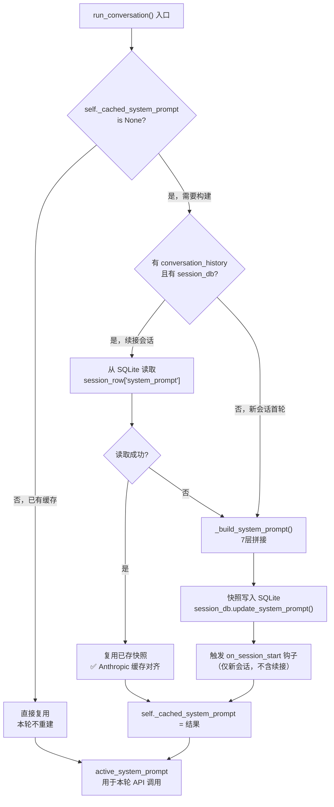
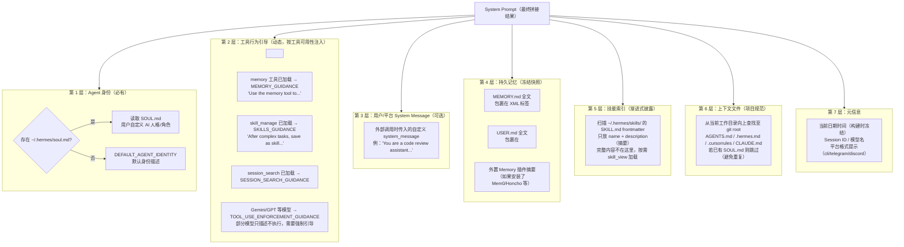
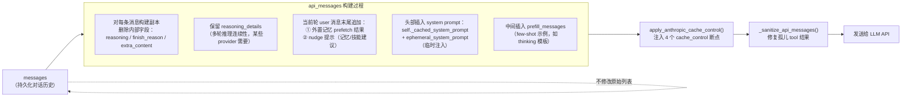

# 七、Prompt 拼接机制

`_build_system_prompt()` 是 Hermes 中最重要的"一次性"操作，也是整个 Agent 架构中与成本最直接相关的设计决策。

**结论先行**：System Prompt 整个会话只构建一次，然后永久缓存。这个决策的核心驱动力不是性能，而是**成本**——Anthropic 的 prefix cache 要求缓存内容（system 前缀）在多轮对话间保持完全一致，任何一个字节的变化都会导致缓存失效，输入 token 费用从原价的 10% 跳回 100%。

一个典型的 Hermes 会话，system prompt 约 3000~8000 token。如果每轮都全量计费，20 轮对话就额外消耗 6~16 万 token。冻结快照设计让这部分成本降至接近零。

---

## System Prompt 构建全流程



## System Prompt N 层结构



## System Prompt 逐层解析（实例分析）

对一次真实 Hermes 运行时产生的 System Prompt 进行逐层拆解，对照 `run_agent.py::_build_system_prompt()` 的组装逻辑，说明每段内容的来源、生成时机和作用。

### Build 流程总览

`_build_system_prompt()` 在**每个会话首轮调用一次**，结果缓存到 `self._cached_system_prompt`，只有在上下文压缩时才会重建。组装顺序固定如下：

```
Layer 1  │ 代理身份           SOUL.md  或  DEFAULT_AGENT_IDENTITY（硬编码兜底）
Layer 2  │ 工具行为引导        MEMORY_GUIDANCE + SESSION_SEARCH_GUIDANCE + SKILLS_GUIDANCE（按工具是否可用条件注入）
Layer 3  │ Nous 订阅提示       build_nous_subscription_prompt()（商业功能，按工具可用性注入）
Layer 4  │ 工具使用强制引导    TOOL_USE_ENFORCEMENT_GUIDANCE（按模型类型条件注入）
Layer 5  │ 外部 system_message 用户 / Gateway 传入的自定义 system prompt（如有）
Layer 6  │ 持久记忆            MEMORY.md + USER.md
Layer 7  │ 外部 memory provider build_system_prompt()（mem0、holographic 等，如已配置）
Layer 8  │ 技能索引            build_skills_system_prompt()（两级缓存的紧凑 skills 目录）
Layer 9  │ 上下文文件          build_context_files_prompt()（AGENTS.md / SOUL.md / .cursorrules 等）
Layer 10 │ 时间戳 + 元信息     会话开始时间、Session ID、Model、Provider
Layer 11 │ 平台提示            PLATFORM_HINTS[platform]（cli / telegram / discord 等）
```

### 各层详解（以真实 Prompt 为例）

#### Layer 1 — 代理身份（SOUL.md）

**来源**：`~/.hermes/SOUL.md`，`load_soul_md()` 加载，优先于硬编码的 `DEFAULT_AGENT_IDENTITY`。  

**生成时机**：会话首轮，冻结在 `_cached_system_prompt` 中。  

**作用**：定义 Agent 的人格、语气和核心行为规范。

```
# Hermes Agent Persona

<!--
This file defines the agent's personality and tone.
The agent will embody whatever you write here.
Edit this to customize how Hermes communicates with you.
...
-->
```

这段 注释是 SOUL.md 的说明文件头，实际内容是空的（用户未自定义），因此下方的 tool_guidance 段直接跟上（两块之间用 `\n\n` 拼接）。

#### Layer 2 — 工具行为引导（Tool Guidance）

**来源**：`agent/prompt_builder.py` 中三个常量，按工具可用性条件注入：

- `memory` 工具可用 → 注入 `MEMORY_GUIDANCE`
- `session_search` 工具可用 → 注入 `SESSION_SEARCH_GUIDANCE`
- `skill_manage` 工具可用 → 注入 `SKILLS_GUIDANCE`

**生成时机**：会话首轮，条件检查 `self.valid_tool_names`。  

**作用**：告诉模型这三类工具的使用策略，防止滥用或漏用。

:::collapse{active nodeId="c3aa33f1d9d345029777e8c170d48763" titleNodeId="a59e1a77-8fe2-403f-a35d-dd599bbb5509" contentNodeId="10e5419c-fbbc-4d24-a244-3c117bd8a756"}

MEMORY_GUIDANCE 原文

---

```
You have persistent memory across sessions. Save durable facts using the memory
tool: user preferences, environment details, tool quirks, and stable conventions.
Memory is injected into every turn, so keep it compact and focused on facts that
will still matter later.
Prioritize what reduces future user steering — the most valuable memory is one
that prevents the user from having to correct or remind you again. User
preferences and recurring corrections matter more than procedural task details.
Do NOT save task progress, session outcomes, completed-work logs, or temporary
TODO state to memory; use session_search to recall those from past transcripts.
If you've discovered a new way to do something, solved a problem that could be
necessary later, save it as a skill with the skill tool.
```

**扩展部分**：本例 Prompt 中还出现了比 `MEMORY_GUIDANCE` 常量更多的文字（"Write memories as declarative facts..."），这部分属于用户自定义内容，写入了 SOUL.md，与硬编码常量叠加注入。

:::collapse{nodeId="4bcfbaaa960d4dfe80c2c753aa601ec1" titleNodeId="2b679d6d-7278-4cc8-9e9e-293bfed7d273" contentNodeId="8b671716-cf47-4217-9327-0e8c54354ec1"}

SESSION_SEARCH_GUIDANCE 原文

---

```
When the user references something from a past conversation or you suspect
relevant cross-session context exists, use session_search to recall it before
asking them to repeat themselves.
```

:::collapse{nodeId="69344326109740c1a10c0a2a39dc4768" titleNodeId="ec804124-e9ee-4124-a02d-b32d5a3ab37d" contentNodeId="ba1943a9-f6b7-4619-84f0-4b56f4e44d76"}

SKILLS_GUIDANCE 原文

---

```
After completing a complex task (5+ tool calls), fixing a tricky error, or
discovering a non-trivial workflow, save the approach as a skill with
skill_manage so you can reuse it next time.
When using a skill and finding it outdated, incomplete, or wrong, patch it
immediately with skill_manage(action='patch') — don't wait to be asked.
Skills that aren't maintained become liabilities.
```

#### Layer 6 — 持久记忆（MEMORY.md + USER.md）

**来源：**`**~/.hermes/memories/MEMORY.md**`** 和 **`**~/.hermes/memories/USER.md**`**，两个纯文本文件，由 **`**MemoryStore**`** 类管理（**`**tools/memory_tool.py**`**）。**

**生成时机：Agent 初始化时 **`**load_from_disk()**`** 读取文件，生成 **`**_system_prompt_snapshot**`** 冻结快照，会话首轮通过 **`**format_for_system_prompt()**`** 格式化后注入。**

**作用：将跨会话积累的持久性事实注入上下文，无需用户每次重复告知。**

:::collapse{active nodeId="418e79886afd471396eaf54ea21164eb" titleNodeId="12557b95-6d06-44d3-b593-ba5ee73b3043" contentNodeId="f993d81a-4d0b-40ad-8862-cd28dd6087a3"}

MEMORY.md 输出示例

---

```
══════════════════════════════════════════════
MEMORY (your personal notes) [99% — 2,199/2,200 chars]
══════════════════════════════════════════════
Stable Diffusion 环境 (2026-04-15 更新):
§  SD WebUI 位置: ~/stable-diffusion-webui
§  模型: v1-5-pruned-emaonly.safetensors (4GB，已下载)
§  User: Chinese language user
§  MIS: chengpengtao
```

`[99% — 2,199/2,200 chars]` 是 memory store 自动计算的容量百分比。`§` 是条目分隔符。

#### Layer 8 — 技能索引（Skills Prompt）

**来源**：`build_skills_system_prompt()` 扫描 `~/.hermes/skills/` 目录生成紧凑索引，采用两级缓存（LRU 字典 + 磁盘快照 `.skills_prompt_snapshot.json`）。  

**作用**：提供可用技能目录，让模型在任务开始前扫描并按需加载相关技能。

:::collapse{nodeId="3ab2367c248a4a089cf83e31d126653c" titleNodeId="fbb462b1-35a9-4b2e-9c37-86d47e2b5db8" contentNodeId="32600df6-c3d6-437d-b40f-974d0d0db152"}

Skills Prompt 格式示例

---

```
## Skills (mandatory)
Before replying, scan the skills below. If a skill matches or is even partially
relevant to your task, you MUST load it with skill_view(name) and follow its instructions.

<available_skills>
  apple: Apple/macOS-specific skills — iMessage, Reminders, Notes, FindMy...
    - apple-notes: Manage Apple Notes via the memo CLI on macOS
  autonomous-ai-agents: Skills for spawning and orchestrating autonomous AI agents...
    - claude-code: Delegate coding tasks to Claude Code
    - hermes-agent: Complete guide to using and extending Hermes Agent
  ... （其余技能分类省略）
</available_skills>

Only proceed without loading a skill if genuinely none are relevant to the task.
```

#### Layer 10 — 时间戳 + 元信息

**来源**：`run_agent.py` 直接拼接，`hermes_time.now()` 获取当前时间，在**构建时冻结**（同一会话内不会更新）。  

**作用**：让模型知道当前时间、所用模型和 Provider，避免使用训练时的过期信息。

```
Conversation started: Wednesday, April 22, 2026 02:59 PM
Model: MiniMax-M2.7
Provider: custom
```

#### Layer 11 — 平台提示（Platform Hints）

**来源**：`PLATFORM_HINTS["cli"]`，在 `prompt_builder.py` 中定义，按 `self.platform` 值选择，不存在则跳过。  

**作用**：告知模型当前运行环境的输出约束（是否支持 Markdown、媒体发送方式等）。

```
You are a CLI AI Agent. Try not to use markdown but simple text renderable
inside a terminal.
```

#### 层级汇总

| 层级 | 内容片段（摘要） | 来源文件/常量 | 是否冻结 |
|---|---|---|---|
| 1 | `# Hermes Agent Persona` + HTML 注释头 | `~/.hermes/SOUL.md` | ✅ 冻结 |
| 2a | `You have persistent memory...` (MEMORY_GUIDANCE) | `agent/prompt_builder.py` | ✅ 冻结 |
| 2b | `Write memories as declarative facts...` | `~/.hermes/SOUL.md`（用户自定义追加） | ✅ 冻结 |
| 2c | `When the user references...` (SESSION_SEARCH_GUIDANCE) | `agent/prompt_builder.py` | ✅ 冻结 |
| 2d | `After completing a complex task...` (SKILLS_GUIDANCE) | `agent/prompt_builder.py` | ✅ 冻结 |
| 6a | `MEMORY (your personal notes)` + 具体条目 | `~/.hermes/MEMORY.md` (SQLite) | ✅ 冻结快照 |
| 8 | `## Skills (mandatory)` + `<available_skills>` | `~/.hermes/skills/` 目录扫描 | ✅ 冻结（两级缓存） |
| 10 | `Conversation started: ...` + Model + Provider | `run_agent.py` 直接拼接 | ✅ 冻结（构建时时间戳） |
| 11 | `You are a CLI AI Agent...` | `PLATFORM_HINTS["cli"]` | ✅ 冻结 |

**本例缺席的层级**：Layer 3（Nous 订阅，需商业授权）、Layer 4（工具强制引导，MiniMax-M2.7 不在名单）、Layer 7（外部 memory provider 未配置）、Layer 9（无 AGENTS.md 等上下文文件）。

---

---

## Prompt Caching：4 个断点的战略布局

Anthropic 允许最多 4 个 `cache_control` 断点。Hermes 的布局策略最大化了缓存收益：

```
api_messages（最终发送给 Anthropic 的版本）：

位置 [0] system message：
  {"role":"system", "content":[{
      "type":"text",
      "text":"...(7层拼接结果)...",
      "cache_control":{"type":"ephemeral"}  ← 断点 1
  }]}
  收益：最大。system 在所有轮次完全不变，每轮都命中。

位置 [N-3] 第三近的非 system 消息：
  {"role":"assistant", "content":[{..., "cache_control":{...}}]}
                                          ↑ 断点 2（滑动窗口）

位置 [N-2] 第二近的非 system 消息：
  {"role":"tool", "content":"...", "cache_control":{...}}
                                   ↑ 断点 3

位置 [N-1] 最近的非 system 消息（通常是当前 user 消息）：
  {"role":"user", "content":[{..., "cache_control":{...}}]}
                                   ↑ 断点 4

策略：断点 1 在 system（不动），断点 2~4 随对话推进滑动，
      保证最新的 3 条历史消息也被缓存（下一轮复用）
```

**实际节省效果**：

| 场景 | 无缓存 | 有缓存（当前设计） | 节省 |
|---|---|---|---|
| system prompt 4000 token × 20 轮 | 80,000 token | ~5,000 token（首轮全量，后续 10%） | ~94% |
| 历史消息 10,000 token × 每轮 | 每轮 10,000 | ~2,000（命中的部分） | ~80% |

---

## api_messages 的临时注入层

每次 LLM 调用前，在 `api_messages`（messages 的临时副本）上还会叠加动态内容，**但绝不修改原始 messages 列表**：



## FAQ

### 为什么设计决策都是为了保护缓存

理解 Hermes Prompt 设计的关键，是认识到**几乎所有"奇怪"的设计决策都是为了不破坏 Anthropic prefix cache**：

```
设计决策 1：记忆写入不立即更新 system prompt
  原因：MEMORY.md 更新 → system prompt 变化
       → Anthropic prefix cache 失效
  方案：记忆立即写磁盘，但 system prompt 下次会话才更新

设计决策 2：外部记忆 prefetch 注入 user 消息，不注入 system prompt
  原因：每次 recall 结果不同（按当前问题语义检索）
       → 若放 system → 每轮 system 都不同 → 缓存永远失效
  方案：注入 user 消息末尾，system 保持稳定

设计决策 3：技能完整内容不在 system prompt（只放摘要索引）
  原因：每次激活的技能不同
       → 若技能全文在 system → 每次换技能都破坏缓存
  方案：system 只放摘要索引（稳定），完整内容通过 skill_view 工具加载

共同原则：
  稳定内容（身份、记忆快照、技能索引）→ system prompt（冻结）
  动态内容（recall 结果、技能全文、nudge）→ user 消息（每轮可变）
```

---

### ephemeral_system_prompt 是什么

`ephemeral_system_prompt` 是 Hermes 中专门用于**动态、临时**内容注入的机制——它在每次 API 调用时追加到已冻结的 system prompt 后面，但永远不会进入 `_cached_system_prompt`，也不会持久化到会话数据库。

#### 核心机制

每次 API 调用时，最终发送给 LLM 的 system 是两部分的拼接：

```
effective_system = _cached_system_prompt  +  "\n\n"  +  ephemeral_system_prompt
                ↑ 冻结、缓存、持久化                  ↑ 动态附加、不缓存、不持久化
```

对应源码（`run_agent.py`）：

```
effective_system = self._cached_system_prompt or ""
if self.ephemeral_system_prompt:
    effective_system = (effective_system + "\n\n" + self.ephemeral_system_prompt).strip()
if effective_system:
    api_messages = [{"role": "system", "content": effective_system}] + api_messages
```

#### 三种注入来源

##### 来源 1：CLI --system 参数 / config.yaml 的 agent.system_prompt

```
# CLI 启动时传入
hermes --system "You are a concise assistant. Reply in one sentence max."

# 或写到 config.yaml
agent:
  system_prompt: "You are a concise assistant. Reply in one sentence max."
```

CLI 初始化逻辑（`cli.py`）：

```
self.system_prompt = (
    os.getenv("HERMES_EPHEMERAL_SYSTEM_PROMPT", "")
    or CLI_CONFIG["agent"].get("system_prompt", "")
)
```

##### 来源 2：/personality 命令切换人格

`config.yaml` 中内置了 4 种人格模板，`/personality <name>` 命令会即时更新 `ephemeral_system_prompt`，**无需重启会话即可生效**：

```
# config.yaml 内置人格
personalities:
  helpful:   "You are a helpful, friendly AI assistant."
  concise:   "You are a concise assistant. Keep responses brief and to the point."
  technical: "You are a technical expert. Provide detailed, accurate technical information."
  creative:  "You are a creative assistant. Think outside the box."
```

`/personality none` 可清除人格覆盖，恢复基础行为。

##### 来源 3：Gateway 平台上下文（自动注入）

Gateway 模式下，`ephemeral_system_prompt` 由两部分合并而来：

```
combined_ephemeral = context_prompt          # 平台上下文（自动生成）
                   + self._ephemeral_system_prompt   # 用户配置的自定义 prompt
```

`context_prompt` 的真实内容示例（来自 `build_session_context_prompt()`）：

```
## Current Session Context

**Source:** Telegram (DM with @chengpengtao)
**User:** chengpengtao
**Connected Platforms:** local (files on this machine), telegram: Connected ✓
**Home Channels (default destinations):**
  - telegram: My DM (ID: 123456789)

**Delivery options for scheduled tasks:**
- "origin" → Back to this chat (My DM)
- "local" → Save to local files only (~/.hermes/cron/output/)
- "telegram" → Home channel (My DM)
```

还可能追加特殊场景注解：

```
# 用户首次对话
[System note: This is the user's very first message ever.
Briefly introduce yourself and mention that /help shows available commands.
Keep the introduction concise -- one or two sentences max.]

# 会话因超时自动重置
[System note: The user's previous session expired due to inactivity.
This is a fresh conversation with no prior context.]
```

##### 与 _cached_system_prompt 的对比

| 对比维度 | _cached_system_prompt | ephemeral_system_prompt |
|---|---|---|
| 写入时机 | 会话首轮一次性构建 | 每次 API 调用时临时拼接 |
| 是否缓存 | 是（Anthropic prompt caching） | 否，跳过缓存前缀 |
| 是否持久化 | 会话结束后存 session DB | 不存 DB |
| 修改后生效时机 | 需重建（压缩或新会话时触发） | 立即生效（下一轮即生效） |
| 典型内容 | 身份 / memory / skills / 时间戳 | 人格覆盖 / 平台上下文 / 临时指令 |
| 设计目的 | 稳定前缀，最大化 cache hit 率 | 灵活注入动态信息，不破坏缓存 |

> 一句话总结
> ---
> `ephemeral_system_prompt` 是"每次说悄悄话"——贴在已冻结的 system prompt 后面，不留痕迹，不影响缓存，随时可以换。
