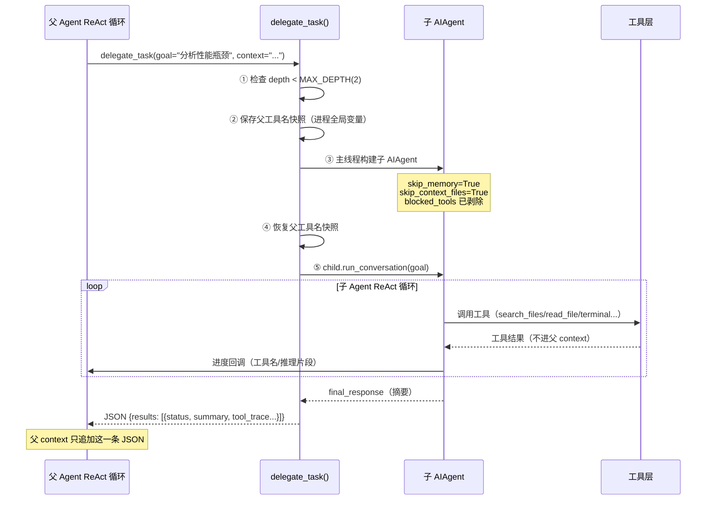

# 八、子 Agent 委托（delegate_task）

> **结论先行**：`delegate_task` 是 Hermes 的"任务外包"机制。父 Agent 遇到复杂子任务时，通过 `delegate_task` 生成一个独立的子 AIAgent，让它单独完成一段 ReAct 循环，最终只把摘要结果汇报给父 Agent。父 Agent 的上下文窗口只看到"委托了什么 + 得到什么结果"，子 Agent 产生的数十次工具调用全部被隔离，不污染父 Agent 的 context。

---

## 8.1 为什么需要子 Agent 委托？

在单 Agent 模式下，每次工具调用的 input/output 都追加到 conversation history，复杂任务（如"分析整个代码库并生成报告"）会迅速撑爆上下文窗口，且中间大量工具调用结果干扰 LLM 推理。

子 Agent 委托的核心价值：

- **上下文隔离**：子 Agent 所有中间推理 + 工具调用结果不进入父 Agent context
- **并行加速**：最多 3 个子任务并行执行（`MAX_CONCURRENT_CHILDREN=3`）
- **灵活路由**：子 Agent 可使用不同 model/provider，适合"廉价模型做细活"

---

## 8.2 完整委托流程



---

## 8.3 代码：子 Agent 构建关键逻辑

```python
# tools/delegate_tool.py

# 禁止子 Agent 使用的工具集
DELEGATE_BLOCKED_TOOLS = frozenset([
    "delegate_task",   # 禁止递归委托（防无限嵌套）
    "clarify",         # 禁止向用户提问（子 Agent 无用户交互）
    "memory",          # 禁止写 MEMORY.md（并发污染风险）
    "send_message",    # 禁止跨平台消息副作用
    "execute_code",    # 子 Agent 应逐步推理，不写脚本
])

MAX_DEPTH = 2          # 父(0) → 子(1) → 孙(拒绝)
MAX_CONCURRENT_CHILDREN = 3  # 批量并行上限

def _build_child_agent(task_index, goal, context, toolsets, ...):
    # 工具集继承：只能用父 toolsets 的交集，再剥除 blocked
    child_toolsets = _strip_blocked_tools(
        [t for t in toolsets if t in parent_toolsets]
    )

    child = AIAgent(
        model=effective_model,
        enabled_toolsets=child_toolsets,
        max_iterations=max_iterations,   # 独立迭代预算（默认 50）
        ephemeral_system_prompt=child_prompt,
        skip_memory=True,                # 不加载父 MEMORY.md
        skip_context_files=True,         # 不加载 AGENTS.md 等
        quiet_mode=True,
    )
    child._delegate_depth = parent._delegate_depth + 1
    # 共享父 CredentialPool，子任务限速时能自动轮换 API Key
    child._credential_pool = parent._credential_pool
    return child
```

---

## 8.4 进度可视化：两种展示路径

子 Agent 执行时，工具调用进度通过 progress callback 实时回报：

```
CLI 模式（树形，打印在委托 spinner 上方）：
  🔀 Delegating: analyze performance bottlenecks...
    [1] ├─ 🔍 search_files  "def .*query"
    [1] ├─ 📖 read_file  "app/models.py"
    [1] ├─ 💭 "Found N+1 query in UserModel.get_friends()"
    [1] ├─ 🖥  terminal  "python -m pytest tests/ -q"
  ✓ [1/1] analyze performance bottlenecks  (12.3s)

Gateway 模式（每 5 个工具调用批量推送，减少消息数量）：
  🔀 [1] search_files, read_file, terminal, patch, read_file
```

---

## 8.5 两种执行模式对比

| 特性 | 单任务模式 | 批量并行模式 |
|---|---|---|
| 调用方式 | `delegate_task(goal="...")` | `delegate_task(tasks=[...])` |
| 执行方式 | 主线程直接运行 | `ThreadPoolExecutor` 并发 |
| 最大并行数 | 1 | 3 |
| 适用场景 | 单个复杂子任务 | 多个相互独立的子任务 |
| 父等待策略 | 阻塞等待完成 | `as_completed` 逐个收割 |

---

## 8.6 委托深度限制

```
父 Agent (depth=0)
    └── 子 Agent (depth=1)   ← 允许，depth < MAX_DEPTH
             └── 孙 Agent    ← 被拒绝！
                 返回: "Delegation depth limit reached (2).
                        Subagents cannot spawn further subagents."
```

这是工程安全阀：防止 LLM 产生无限递归委托，避免 API 费用失控。

---

## 8.7 返回结构（父 Agent 看到的）

```python
# 父 context 追加的最终 JSON
{
    "results": [
        {
            "task_index": 0,
            "status": "completed",      # completed / failed / interrupted
            "summary": "分析完成：发现 3 处 N+1 查询...",  # 唯一进父 context 的内容
            "api_calls": 8,             # 子 Agent LLM 调用次数
            "duration_seconds": 12.3,
            "exit_reason": "completed",  # completed / max_iterations / interrupted
            "tokens": {"input": 4200, "output": 850},
            "tool_trace": [             # 工具调用摘要（不含结果内容，仅元数据）
                {"tool": "search_files", "args_bytes": 45, "result_bytes": 2100, "status": "ok"},
                {"tool": "read_file",    "args_bytes": 30, "result_bytes": 5200, "status": "ok"},
            ]
        }
    ],
    "total_duration_seconds": 12.5
}
```

---

## 8.8 FAQ：子 Agent 高频问题

### Q1：模型认为有 5 个任务，但 `maxItems: 3` 限制了每次只能派 3 个，剩余 2 个如何处理？

**答**：不会自动续发，代码里没有分批机制。全流程分三层：

**第一层（Schema 约束）**：`tasks` 数组的 `maxItems: 3` 告知模型"每次最多填 3 个"，模型遵守 Schema 生成工具调用时自行限制。

**第二层（代码兜底截断）**：即使模型违规传入更多，代码也强制截断：

```python
# tools/delegate_tool.py L610
task_list = tasks[:MAX_CONCURRENT_CHILDREN]   # [:3]，第4、5个直接丢弃
```

**第三层（模型自主分批）**：模型在 ReAct 循环中，看到第1批 3 个完成的 Observation 后，自主决定是否再次调用 `delegate_task` 提交剩余任务。这是多轮工具调用，代码层**没有**自动续发逻辑。

```
第1轮：delegate_task(tasks=[任务1, 任务2, 任务3])  → 父 Agent 阻塞
                                                     ↓ 3个子 Agent 并行完成
                                              Observation 进入父 context
第2轮：模型自主决定 → delegate_task(tasks=[任务4, 任务5])
```

### Q2：同一个 `tasks` 数组里的多个任务，代码如何执行？是并行还是串行？

**答**：只要进入同一个 `tasks` 数组，**无条件并行执行**，代码里没有任何依赖检测逻辑。

```python
# tools/delegate_tool.py L670
with ThreadPoolExecutor(max_workers=MAX_CONCURRENT_CHILDREN) as executor:
    futures = {}
    for i, t, child in children:
        future = executor.submit(_run_single_child, ...)  # 全部一次性投入线程池
        futures[future] = i
    for future in as_completed(futures):   # as_completed：谁先完成先收割谁
        results.append(future.result())
```

**串行是如何实现的**？模型通过多轮调用天然实现：前一次 `delegate_task` 的 Observation 没回来之前，模型无法发起下一轮，所以有依赖的任务只要分开两次调用就是串行。

**判断逻辑完全在模型侧**：Schema 描述中写了 `"Parallel independent workstreams"`，引导模型只把相互独立的任务放进同一个 `tasks` 数组；有依赖的任务则分开多轮调用。

### Q3：父 Agent → 子 Agent → 孙 Agent 三层结构如何触发和被阻断？

**答**：深度通过 `_delegate_depth` 属性在实例间传递，双重防线确保孙级无法再委派：

**深度传递**（`_build_child_agent` 中）：

```python
# tools/delegate_tool.py L370
child._delegate_depth = getattr(parent_agent, '_delegate_depth', 0) + 1
# 父 Agent 无此属性 → 默认 0；子 Agent 得到 1；孙 Agent 得到 2
```

**入口拒绝**（`delegate_task` 函数起始处）：

```python
# tools/delegate_tool.py L584
depth = getattr(parent_agent, '_delegate_depth', 0)
if depth >= MAX_DEPTH:   # MAX_DEPTH = 2
    return json.dumps({"error": "Delegation depth limit reached (2). Subagents cannot spawn further subagents."})
```

**工具集剥离（第二道防线）**：子 Agent 在构建时，`delegation` toolset 被从工具列表中移除，孙 Agent 根本看不到 `delegate_task` 工具：

```python
# tools/delegate_tool.py L134
blocked_toolset_names = {"delegation", "clarify", "memory", "code_execution"}
return [t for t in toolsets if t not in blocked_toolset_names]
```

深度层级总结：

```
父 Agent  _delegate_depth=0  可委派
  └─ 子 Agent  _delegate_depth=1  可委派（depth 1 < MAX_DEPTH 2）
       └─ 孙 Agent  _delegate_depth=2  被拒绝（depth 2 >= MAX_DEPTH 2）
                                         + 工具列表里根本没有 delegate_task
```

### Q4：`maxItems: 3` 与代码 `[:3]` 截断有什么区别？各自作用是什么？

**答**：两者是不同层次的防护，缺一不可：

| 对比项 | `maxItems: 3`（Schema） | `tasks[:3]`（代码） |
|---|---|---|
| 作用对象 | 模型生成工具调用参数时 | 运行时接收到的参数 |
| 触发时机 | 模型写 JSON 参数阶段 | `delegate_task()` 函数执行阶段 |
| 超出后行为 | 模型遵守规范，不会超过 3 个 | 第 4 个及以后静默丢弃 |
| 目的 | 引导模型行为 | 工程兜底，防御模型越界 |

两者配合形成"引导 + 兜底"双保险，即使未来换模型或模型偶发违规，代码层也能保证最多 3 个任务并发。

### Q5：子 Agent 的工具集是如何从父 Agent 继承的？会不会拿到父 Agent 没有的工具？

**答**：子 Agent 工具集只会是父 Agent 工具集的**子集**，绝不会扩权：

```python
# tools/delegate_tool.py L291
if toolsets:
    # 显式指定：取与父 toolsets 的交集，防止子 Agent 越权获取父没有的工具
    child_toolsets = _strip_blocked_tools([t for t in toolsets if t in parent_toolsets])
elif parent_agent and parent_enabled is not None:
    # 未指定：直接继承父的 enabled_toolsets
    child_toolsets = _strip_blocked_tools(parent_enabled)
else:
    child_toolsets = _strip_blocked_tools(DEFAULT_TOOLSETS)  # ["terminal","file","web"]
```

继承公式：`父 toolsets ∩ 显式指定 toolsets → 再剥除 blocked → 子 toolsets`

被强制剥除的工具集（无论如何都不会给子 Agent）：

```python
DELEGATE_BLOCKED_TOOLS = frozenset([
    "delegate_task",  # 防递归委派
    "clarify",        # 无用户交互
    "memory",         # 防并发写 MEMORY.md
    "send_message",   # 防跨平台副作用
    "execute_code",   # 子 Agent 应逐步推理
])
```
