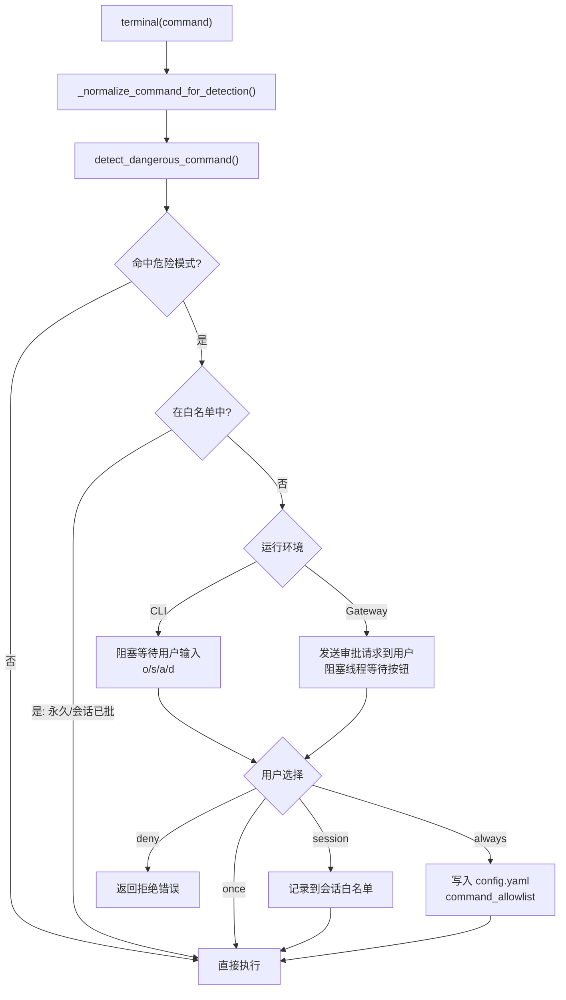

# 十一、execute_code（程序化工具调用待验证）

> **结论先行**：`execute_code` 是 Hermes 的"批处理加速器"。传统 ReAct 循环中，LLM 每次只能调用一个工具，N 步操作需要 N 次 LLM inference。PTC（Programmatic Tool Calling）模式让 LLM 写一段 Python 脚本，脚本通过 RPC 批量调用工具，**N 步只需 1 次 LLM 推理**，中间工具结果不进入 context window，大幅降低成本和延迟。

---

## 11.1 传统 ReAct vs PTC 对比

```
传统 ReAct 循环（N 步需要 N 次 LLM 推理）：
  LLM → 调用 search_files → 结果进 context
  LLM → 调用 read_file    → 结果进 context
  LLM → 调用 web_search   → 结果进 context
  LLM → 调用 write_file   → 结果进 context
  4 次 LLM inference，4 次 API 费用

PTC 模式（N 步只需 1 次 LLM 推理）：
  LLM → 生成 Python 脚本
       脚本内批量调用：search_files → read_file → web_search → write_file
       所有中间结果不进 context window
  只需 1 次 LLM inference + 迭代预算退还机制
```

---

## 11.2 完整执行流程



## 11.3 两种传输模式

### 本地模式：Unix Domain Socket（UDS）

```
父进程（Hermes Agent）
    │
    ├─ 生成 hermes_tools.py（RPC stub 模块，含 UDS _call 函数）
    ├─ 开启 UDS 套接字监听线程
    │    路径：~/.hermes/tmp/hermes_rpc_{uuid}.sock
    ├─ subprocess.Popen 启动子进程
    │    环境变量：HERMES_RPC_SOCKET=路径
    │
    │  ← UDS 双向通信（JSON Lines）
    │
子进程（LLM 脚本）
    import hermes_tools
    # hermes_tools.read_file() 内部调用 _call("read_file", {...})
    # _call 通过 UDS socket 发送请求，等待响应
```

### 远端模式：文件 RPC（Docker/SSH/Modal）

```
本地父进程                       远端环境（如 Docker 容器）
    │  上传 hermes_tools.py          │
    │  上传 user_script.py           │
    ├────────────────────────────────► 执行 python user_script.py
    │                                │
    │  轮询 req_XXXXXX 文件 ◄────────┤ 写 req_XXXXXX（工具调用请求）
    │  执行工具                      │
    │  写 res_XXXXXX ────────────────► 读 res_XXXXXX（工具响应）
    │                                │
    │  读取 stdout 文件 ◄────────────┤ print(result) → stdout 文件
```

---

## 11.4 hermes_tools.py 内容示例

LLM 编写的脚本 `import hermes_tools` 后即可调用所有授权工具：

```python
# 自动生成的 hermes_tools.py（本地 UDS 模式节选）
import json, os, socket, shlex, time

def _connect():
    global _sock
    if _sock is None:
        _sock = socket.socket(socket.AF_UNIX, socket.SOCK_STREAM)
        _sock.connect(os.environ["HERMES_RPC_SOCKET"])
    return _sock

def _call(tool_name, args):
    conn = _connect()
    request = json.dumps({"tool": tool_name, "args": args}) + "\n"
    conn.sendall(request.encode())
    # 等待响应（同步阻塞）...
    return result

def search_files(pattern, target="content", path="."):
    """Search file contents. Returns dict with 'matches'."""
    return _call("search_files", {"pattern": pattern, "target": target, "path": path})

def read_file(path, offset=1, limit=500):
    """Read file (1-indexed lines). Returns dict with 'content'."""
    return _call("read_file", {"path": path, "offset": offset, "limit": limit})

# ... write_file, patch, terminal, web_search, web_extract
```

---

## 11.5 沙箱安全限制

```python
# tools/code_execution_tool.py

# 允许在脚本内调用的工具白名单（安全子集）
SANDBOX_ALLOWED_TOOLS = frozenset([
    "web_search",    # 搜索
    "web_extract",   # 提取网页
    "read_file",     # 读文件
    "write_file",    # 写文件
    "search_files",  # 搜索文件
    "patch",         # 精准修改
    "terminal",      # 执行命令（仅前台，不支持 background=True）
])

# 资源限制（可在 config.yaml 调整）
DEFAULT_TIMEOUT = 300       # 5 分钟总超时
DEFAULT_MAX_TOOL_CALLS = 50 # 最多 50 次工具 RPC 调用
MAX_STDOUT_BYTES = 50_000   # 50KB stdout 上限
MAX_STDERR_BYTES = 10_000   # 10KB stderr 上限
```

---

## 11.6 迭代预算退还机制

`execute_code` 执行期间，脚本内的工具调用不消耗父 Agent 的 LLM iteration 次数。执行完毕后，退还本次 LLM 调用的预算：

```python
# run_agent.py 中的处理
response = llm.call(...)    # 第 N 次 LLM inference（生成脚本）
result = execute_code(script)  # 脚本执行（期间不触发 LLM）

if result.get("success"):
    # 脚本成功完成了大量工作，这次 inference 值得退款
    self.iteration_budget.refund()  # ← 退还 1 次迭代预算
```

效果：实际使用 1 次 inference 做了 N 步工作，消耗预算为 0（退还后）。

---

## 11.7 典型使用场景：LLM 编写的脚本

```python
# LLM 生成的脚本示例（批量处理 TODO 注释）
import hermes_tools

# 搜索所有 TODO
todos = hermes_tools.search_files(
    pattern="TODO", target="content", path="/app/src"
)

# 逐个读取文件获取上下文
results = []
for match in todos["matches"][:20]:
    content = hermes_tools.read_file(match["file"])
    results.append({"file": match["file"], "content": content["content"][:500]})

# 生成报告
report = "\n".join([f"## {r['file']}\n{r['content']}" for r in results])
hermes_tools.write_file("/app/todo_report.md", report)

print(f"已生成报告，共找到 {len(todos['matches'])} 处 TODO")
# ↑ 只有这一行 print 返回给 LLM，中间所有工具结果不进 context
```
