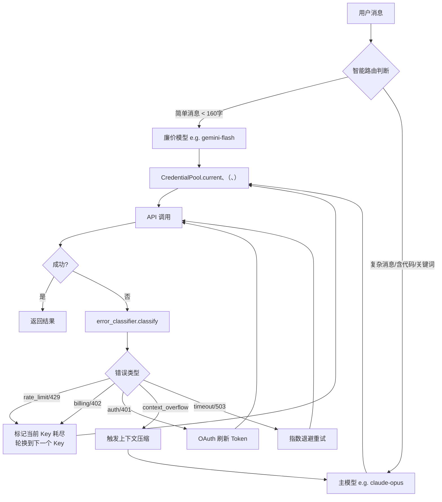

# 十二、智能路由、凭据池与错误恢复(待验证)

> **结论先行**：Hermes 的可靠性由三层机制保障。**智能路由**：简单对话自动降级廉价模型，降低成本；**凭据池**：多 API Key 轮换 + OAuth 自动刷新，确保高并发下不断线；**错误分类与重试**：15 类错误精确分类，对症下药，而非无脑重试。三者协作，让 Hermes 在 API 限速、Key 耗尽、网络抖动等场景下自愈。

---

## 12.1 三层可靠性机制全景




## 12.2 智能模型路由

`agent/smart_model_routing.py` 实现"简单对话降级廉价模型"的启发式策略：

```python
def choose_cheap_model_route(user_message, routing_config):
    """
    保守策略：任何复杂迹象都保持主模型。
    只有明确"看起来简单"时才路由到廉价模型。
    """
    text = user_message.strip()

    # 任一条件触发 → 使用主模型（保守）
    if len(text) > 160:              # 超过 160 字符
        return None
    if len(text.split()) > 28:       # 超过 28 个词
        return None
    if text.count("\n") > 1:         # 多行消息
        return None
    if "```" in text or "`" in text:  # 包含代码块
        return None
    if URL_RE.search(text):           # 包含 URL
        return None

    # 关键词命中复杂任务集合 → 使用主模型
    COMPLEX_KEYWORDS = {
        "debug", "implement", "refactor", "analyze", "deploy",
        "docker", "kubernetes", "optimize", "architect", ...
    }
    if any(w in COMPLEX_KEYWORDS for w in text.lower().split()):
        return None

    # 通过所有检测 → 路由到廉价模型
    return routing_config.cheap_model
```

**不破坏 Prompt 缓存**：路由发生在每轮 LLM 调用前，system prompt 本身不变，Anthropic/OpenAI 的 Prompt 缓存依然有效。

---

## 12.3 凭据池（CredentialPool）

`agent/credential_pool.py` 管理多 API Key 的状态、轮换与 OAuth Token 生命周期。

### 数据结构

```python
@dataclass
class PooledCredential:
    provider: str           # e.g. "anthropic", "openrouter"
    id: str                 # 唯一 ID
    auth_type: str          # "api_key" 或 "oauth"
    access_token: str       # 当前可用 Token
    refresh_token: str      # OAuth 刷新 Token
    last_status: str        # "ok" 或 "exhausted"
    last_error_code: int    # 上次失败的 HTTP 状态码（429/402 等）
    last_error_reset_at: float  # 服务商提供的重置时间戳
    request_count: int      # 历史请求计数
```

### fill_first 策略（默认）

```
Key 池状态：
    key1: status=ok,         requests=450
    key2: status=exhausted,  last_fail_at=14:23, reset_at=15:23
    key3: status=ok,         requests=120

fill_first 选择顺序：
    1. key1（优先用满第一个 Key，充分利用 tier 配额）
    2. key3（key1 耗尽后切换）
    3. key2（等冷却结束后恢复）

对比 round_robin：轮流使用每个 Key，适合均衡场景
对比 least_used：优先选请求数最少的 Key
```

### 故障转移时序

```
API 调用 → 429 Too Many Requests
    │
    ├── 当前 Key 标记为 exhausted
    │   last_error_reset_at = 服务商返回的 reset 时间（若有）
    │   否则默认冷却 1 小时
    │
    ├── credential_pool.get_next() 选下一个可用 Key
    │   ├── 有可用 Key → 切换，立即重试
    │   └── 所有 Key 耗尽 → 等待最短冷却时间后重试
    │
    └── 子 Agent 共享同一 CredentialPool
        子 Agent 限速时也能自动从池中轮换
```

### OAuth Token 自动刷新

对于 Codex、Claude（OAuth 认证方式），凭据池在 Token 过期前 5 分钟自动刷新：

```python
# 刷新触发条件
CODEX_ACCESS_TOKEN_REFRESH_SKEW_SECONDS = 300  # 过期前 5 分钟刷新

if _codex_access_token_is_expiring(entry):
    new_tokens = oauth.refresh(entry.refresh_token)
    pool.update_entry(entry, access_token=new_tokens.access_token)
    # 同步回 ~/.codex/auth.json 或 ~/.claude/.credentials.json
    # 防止外部程序下次加载到旧 token（单次使用 refresh token 保护）
```

---

## 12.4 错误分类体系

`agent/error_classifier.py` 提供**优先级排列的分类流水线**，每次 API 失败都经过以下分类，返回 `ClassifiedError`：

```
分类优先级（从高到低）：

1. Provider 特定模式（最高优先级）
   ├── Anthropic thinking 签名无效 (400 + "signature" + "thinking")
   └── Anthropic 长上下文 tier 限制 (429 + "extra usage" + "long context")

2. HTTP 状态码 + 消息细化
   ├── 401/403 → auth（触发 Token 刷新/轮换）
   ├── 402     → billing（立即轮换 Key，不重试）
   ├── 429     → rate_limit 或 billing（区分：有 "try again" 是 rate_limit）
   ├── 413     → payload_too_large（压缩上下文）
   ├── 500/502 → server_error（退避重试）
   └── 503/529 → overloaded（退避重试）

3. 消息模式匹配（无状态码时）
   ├── "context length" / "too many tokens" → context_overflow（压缩）
   ├── "model not found" / "invalid model"  → model_not_found（切换模型）
   └── 传输错误类型（ReadTimeout, ConnectError 等） → timeout

4. 兜底：unknown（退避重试）
```

### ClassifiedError 结构

```python
@dataclass
class ClassifiedError:
    reason: FailoverReason         # 错误类型枚举
    status_code: Optional[int]     # HTTP 状态码
    message: str                   # 摘要消息

    # 恢复动作提示（run_agent.py 重试循环据此决策）
    retryable: bool                  # 是否值得重试
    should_compress: bool            # 是否触发上下文压缩
    should_rotate_credential: bool   # 是否轮换 API Key
    should_fallback: bool            # 是否切换到备用 Provider
```

---

## 12.5 重试策略（抖动退避）

`agent/retry_utils.py` 实现抖动指数退避，防止多个并发 Agent 的重试同时打到服务商（惊群效应）：

```python
def jitter_backoff(attempt: int, base: float = 1.0, max_delay: float = 60.0) -> float:
    """
    指数退避 + 随机抖动
    attempt=0: 0.5~1.5s
    attempt=1: 1.0~3.0s
    attempt=2: 2.0~6.0s
    attempt=3: 4.0~12.0s
    上限 60s
    """
    delay = base * (2 ** attempt)
    delay = min(delay, max_delay)
    jitter = delay * random.uniform(0.5, 1.5)  # ±50% 随机抖动
    return min(jitter, max_delay)
```

---

## 12.6 错误→恢复动作映射表

| 错误类型 | HTTP | 恢复动作 |
|---|---|---|
| `rate_limit` | 429 | 抖动退避 + 轮换 Key（冷却 1h） |
| `billing` | 402 | 立即轮换 Key（停止重试当前 Key） |
| `auth` | 401/403 | 刷新 OAuth Token，失败则轮换 Key |
| `context_overflow` | 400 | 触发上下文压缩，不轮换 Key |
| `timeout` | - | 重建 HTTP 客户端，退避重试 |
| `overloaded` | 503/529 | 退避重试（不轮换，服务商过载） |
| `server_error` | 500/502 | 退避重试 |
| `model_not_found` | 404 | 切换备用模型/Provider |
| `thinking_signature` | 400 | 清除 thinking block，重试 |
