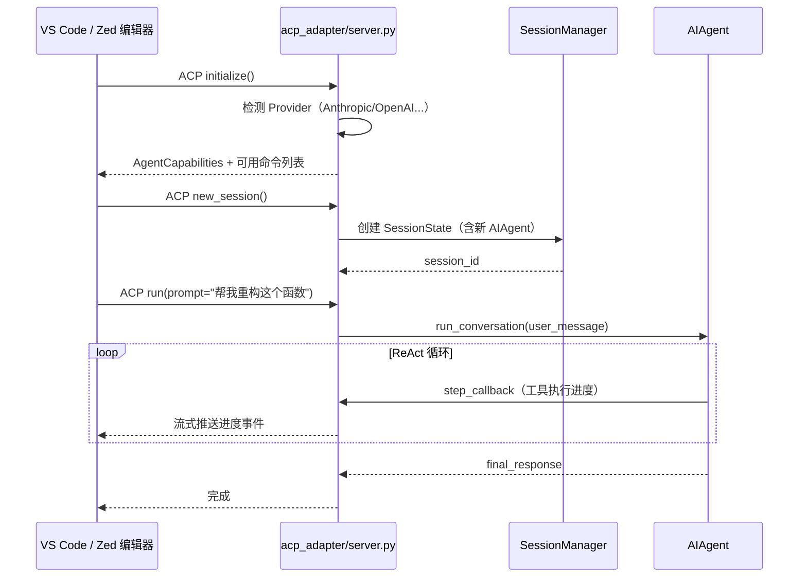
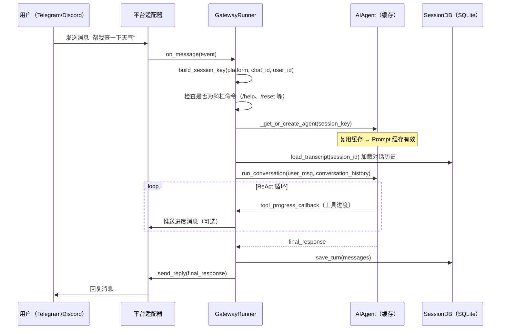

# 十三、终端多环境、ACP 适配器与 Gateway 平台（待验证）

> **结论先行**：Hermes 通过三套扩展机制实现"无处不在"的 Agent 能力。**终端多环境**：`terminal()` 工具调用接口不变，底层自动路由到 local/docker/ssh/modal 等 6 种执行后端；**ACP 适配器**：通过 Agent Communication Protocol 接入 VS Code/Zed/JetBrains 等编辑器，变身代码 AI Agent；**Gateway 平台**：将 Hermes 接入 Telegram/Discord/Slack 等 15 个消息平台，每会话缓存 AIAgent 实例保留 Prompt 缓存，避免每条消息重建 Agent 带来的 10x 费用。

---

## 13.1 终端多环境：同一接口，六种后端

### 为什么需要多环境？

- 本地环境：便捷，但有安全隐患（Agent 直接操作主机）
- Docker 容器：隔离，但需要本地 Docker
- 远程 SSH：在生产服务器执行任务
- Modal/Daytona：弹性云端 GPU/CPU 沙箱，适合训练任务
- Singularity：HPC 集群，学术计算场景

Agent 调用 `terminal()` 的代码完全一致，切换环境只需改配置。

### 六种执行环境

| 环境 | 配置方式 | 适用场景 |
|---|---|---|
| `local` | 默认，无需配置 | 开发本机，最快，直接执行 |
| `docker` | `TERMINAL_ENV=docker` + `TERMINAL_DOCKER_IMAGE` | 隔离容器，不污染主机 |
| `ssh` | `TERMINAL_ENV=ssh` + `TERMINAL_SSH_HOST/USER` | 远程服务器执行任务 |
| `modal` | `TERMINAL_ENV=modal` + Modal API key | 弹性云端 GPU 沙箱 |
| `daytona` | `TERMINAL_ENV=daytona` + Daytona token | 托管开发环境 |
| `singularity` | `TERMINAL_ENV=singularity` + `.sif` 镜像路径 | HPC/科学计算集群 |

### 环境切换透明性

```python
# Agent 调用的工具接口完全一致
terminal("python train.py --epochs 10")

# tools/terminal_tool.py 内部根据 TERMINAL_ENV 自动路由
if TERMINAL_ENV == "modal":
    return _run_in_modal("python train.py --epochs 10")
elif TERMINAL_ENV == "docker":
    return _run_in_docker("python train.py --epochs 10")
elif TERMINAL_ENV == "ssh":
    return _run_via_ssh("python train.py --epochs 10")
else:
    return _run_local("python train.py --epochs 10")
```

---

## 13.2 后台进程管理

`tools/process_registry.py` 追踪所有通过 `terminal(background=True)` 启动的后台进程：

```python
terminal("python server.py", background=True, check_interval=30)
# → 创建后台进程，注册到 ProcessRegistry
# → 每 30 秒检查状态
# → Gateway 推送进度通知（可配置通知级别）
```

通知级别（`display.background_process_notifications`）：

- `all`：运行中输出 + 最终完成消息（默认）
- `result`：只推送最终完成消息
- `error`：只在退出码非 0 时推送
- `off`：静默，不推送

---

## 13.3 ACP 适配器：接入编辑器

`acp_adapter/server.py` 实现 **Agent Communication Protocol (ACP)**，让 Hermes 在 VS Code/Zed/JetBrains 中作为 AI Agent 运行。

### 架构



### 会话管理

```python
# acp_adapter/session.py
class SessionState:
    session_id: str
    agent: AIAgent          # 会话级 AIAgent 实例（长驻）
    conversation_history: list  # 对话历史
    model: str
    mode: str               # "normal" / "auto" / "manual"

class SessionManager:
    _sessions: dict[str, SessionState]  # 按 session_id 索引

    def get_or_create(self, session_id: str) -> SessionState:
        # 复用已有会话，保留对话历史和 Agent 状态
        ...
```

### 支持的编辑器命令

| 命令 | 功能 |
|---|---|
| `/model` | 查看/切换当前模型 |
| `/tools` | 列出可用工具 |
| `/context` | 查看对话上下文统计 |
| `/reset` | 清空对话历史 |
| `/compact` | 压缩上下文 |
| `/version` | 查看 Hermes 版本 |

---

## 13.4 Gateway：接入消息平台

Gateway 让 Hermes 在 Telegram、Discord、Slack 等平台作为聊天机器人运行。

### 支持的平台

| 平台 | 适配器文件 | 配置 key |
|---|---|---|
| Telegram | `platforms/telegram.py` | `telegram.bot_token` |
| Discord | `platforms/discord.py` | `discord.bot_token` |
| Slack | `platforms/slack.py` | `slack.bot_token` |
| WhatsApp | `platforms/whatsapp.py` | `whatsapp.*` |
| Signal | `platforms/signal.py` | `signal.*` |
| HomeAssistant | `platforms/homeassistant.py` | `homeassistant.*` |

### Agent 缓存机制（核心设计）

```python
# gateway/run.py（GatewayRunner）

# Agent 缓存：每会话缓存一个 AIAgent 实例
# 重要：没有此缓存，每条消息都会创建新 AIAgent，
# 每轮重建 system prompt（含 MEMORY.md），破坏 Prompt 缓存
# 导致 Anthropic 等支持缓存的 Provider 费用约增加 10 倍
self._agent_cache: Dict[str, tuple] = {}  # {session_key: (agent, config_signature)}

def _get_or_create_agent(self, session_key, config) -> AIAgent:
    if session_key in self._agent_cache:
        agent, cached_sig = self._agent_cache[session_key]
        if config_signature == cached_sig:
            return agent  # ← 复用缓存 Agent，Prompt 缓存有效！
    # 配置变更则创建新 Agent
    agent = AIAgent(...)
    self._agent_cache[session_key] = (agent, config_signature)
    return agent
```

### Gateway 消息处理完整链路



## 13.5 Cron 定时任务

`cron/scheduler.py` + `cron/jobs.py` 实现定时执行 Agent 任务，并将结果推送到 Gateway 平台：

```yaml
# ~/.hermes/config.yaml
cron_jobs:
  - name: "daily_summary"
    schedule: "0 9 * * *"     # 每天早 9 点
    prompt: "总结昨天的工作进展，检查 GitHub 是否有新 PR 需要关注"
    deliver: telegram           # 推送到 Telegram
    origin:
      platform: telegram
      chat_id: "123456"
```

Cron 任务生命周期：

```
Gateway 后台线程每 60s 调用 tick()
    │
    ├── get_due_jobs() 找到到期任务
    │
    ├── 创建临时 AIAgent（无历史，独立上下文）
    │
    ├── agent.run_conversation(prompt)
    │
    ├── 结果不以 [SILENT] 开头 → 推送到指定平台
    │
    └── mark_job_run() 更新下次执行时间
        save_job_output() 本地保存审计日志
```

---

## 13.6 Hook 事件机制

Gateway 提供 Hook 系统，允许自定义事件处理器：

```python
# gateway/builtin_hooks/ 中的内置 hooks
on_message_received   # 消息进入时
on_agent_started      # Agent 开始处理
on_agent_completed    # Agent 完成
on_tool_called        # 工具被调用
on_session_created    # 新会话创建
```

用户可在 `~/.hermes/gateway_hooks.py` 中自定义 hook 处理器，实现日志记录、审计、自定义路由等需求。
